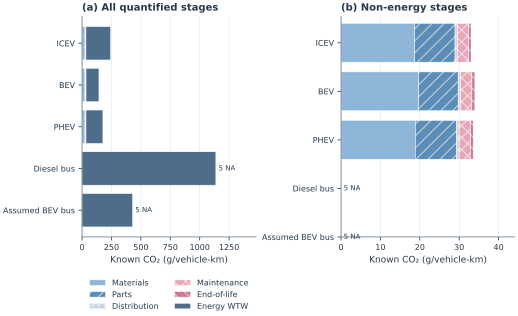
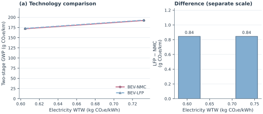
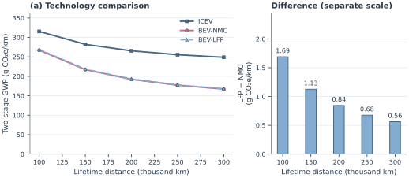
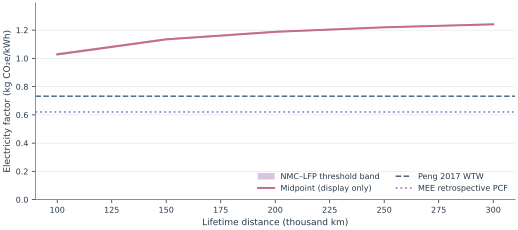
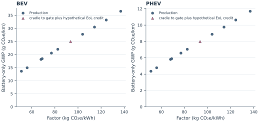
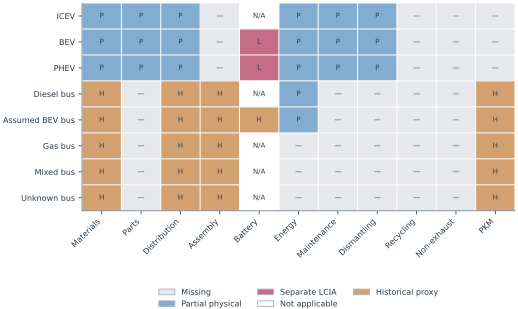
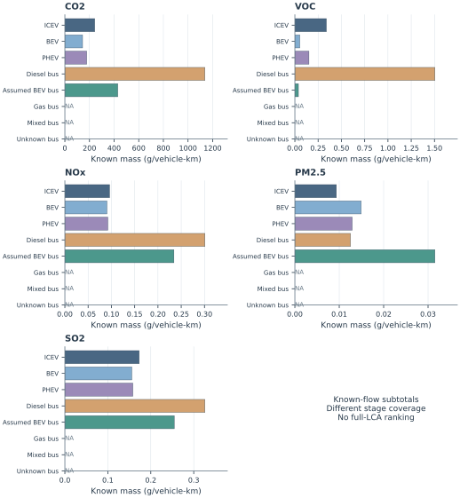
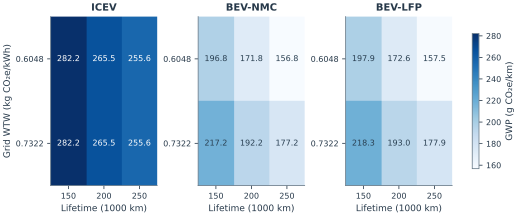
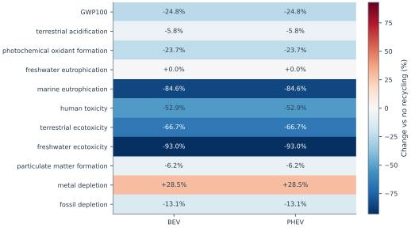

# Retrospective diagnostic figure appendix — not contest-time model results

These figures implement the legacy Figure 3, 5–12 redesign. They use the preserved R9.4/R9.5 retrospective datasets (including activity/energy inputs published after the contest). They are methodological and evidence diagnostics only, and must not be inserted into the strict competition-time results. Old figures and manuscript remain unchanged. Data are read at generation time, not copied from the prior chat.

*A1. Known physical CO₂ by stage: all quantified stages and a separately scaled non-energy panel. Missing components remain NA; this is not full CO₂ inventory.*

*A2. Historical grid sensitivity, distinct NMC/LFP markers and separate difference panel.*

*A3. Historical lifetime curves with separate LFP-minus-NMC difference panel.*

*A4. Historical break-even chemistry band; midpoint is visual only. MEE retrospective reference is not a matched WTW observation.*

*A5. Battery-only factor sensitivity at 150,000 km, separate BEV/PHEV panels.*

*A6. Historical coverage matrix, 88 cells. Historical categories grouped as H; partial data do not establish full LCA.*

*A7. Five separate known physical pollutant mass panels; NA not zero.*

*A8. Historical grid × lifetime sensitivity with shared color scale.*

*A9. Hypothetical 100% recycling changes relative to no credit within each impact category; battery-only.*
