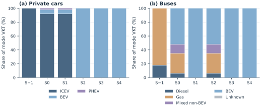
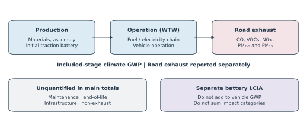
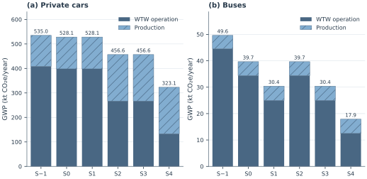
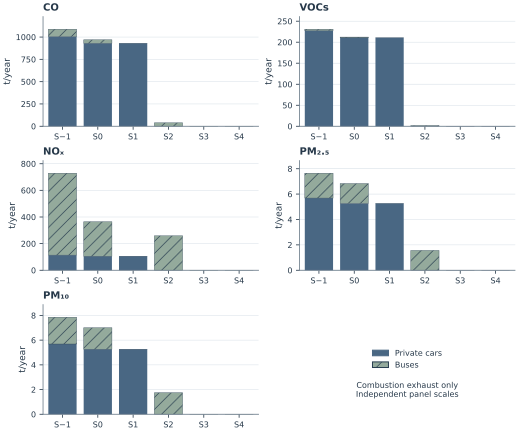
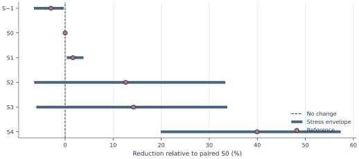
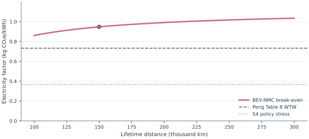

# Environmental Impacts of Vehicle Electrification in a City of One Million Residents

**Team # [to be inserted]**

# Summary Sheet

Question 5 asks us to evaluate the ecological consequences of electrifying new-energy vehicles, including electric buses, in a city with one million residents. We construct a representative-city model rather than treating Beijing itself as the target. Beijing supplies the empirical reference rates for private-car ownership, annual travel and bus operation; these rates are transferred to the hypothetical city under explicit boundary and activity assumptions.

The solution is organized as two linked stages. First, a population-to-transport model estimates the target city's vehicle stock and annual vehicle-kilometres (VKT), then allocates VKT among propulsion types. Second, an environmental-accounting model converts technology-specific VKT into final energy demand, well-to-wheel (WTW) greenhouse-gas emissions, annualized vehicle-production burdens and local road emissions. A supplementary passenger-kilometre (PKM) analysis tests whether occupancy assumptions change the comparison.

Six scenarios are evaluated: a conventional-vehicle reference, the estimated prevailing fleet, bus-first electrification, private-car-first electrification, full electrification and full electrification with a lower-carbon electricity supply. Under the reference assumptions, the million-resident city travels approximately \(1.896\times10^9\) private-car km and \(4.505\times10^7\) bus km per year. The prevailing-mix scenario requires 4.619 PJ of final energy and produces 432.689 kt CO₂e/year from WTW operation. After adding the included vehicle-production burdens, its partial life-cycle GWP is 567.789 kt CO₂e/year. Full electrification reduces final energy to 1.435 PJ and partial GWP to 486.978 kt CO₂e/year, a 14.23% reduction. Halving the electricity WTW factor further lowers partial GWP to 341.002 kt CO₂e/year, 39.94% below the prevailing-mix case.

The environmental priorities differ by indicator. Bus-first electrification reduces modeled road-exhaust NOx by 71.08%, whereas private-car-first electrification gives the larger climate benefit under the reference VKT distribution. Full electrification eliminates the modeled combustion exhaust, but not non-exhaust particle emissions. When generic tyre, brake and road-surface wear factors are included, the reference PM₂.₅ screening total falls from 30.979 to 24.149 t/year and PM₁₀ from 51.755 to 44.751 t/year under full electrification. These are wear-plus-combustion screening totals; resuspended dust and secondary particles remain outside the boundary.

Sensitivity analysis uses paired parameter sets rather than treating a single parameter combination as certain. Across 14,580 designed combinations, the full-electrification climate result ranges from a 6.01% increase to a 33.77% reduction; the lower-carbon-electricity case remains beneficial throughout the tested range. These frequencies and ranges describe the selected stress-test design, not probability distributions. The results support coordinated vehicle and electricity decarbonization, while showing that city activity, vehicle lifetime, fuel use, occupancy and non-exhaust emissions must be considered before making a general claim about environmental benefits.

**Keywords:** urban transport; new-energy vehicles; representative city; vehicle-kilometres; well-to-wheel emissions; life-cycle screening; road pollutants; sensitivity analysis

---

# Contents

1. Introduction  
2. Assumptions and Justifications  
3. Notations  
4. Problem Analysis  
5. Model Establishment  
6. Model Solution and Results  
7. Sensitivity and Error Analysis  
8. Model Verification and Evaluation  
9. Conclusion  
References  
Appendices

---

## 1. Introduction

### 1.1 Background

The environmental consequences of road transport arise from more than the exhaust emitted while a vehicle is being driven. Conventional vehicles require the extraction, processing and distribution of fuels before combustion. Battery-electric vehicles use electricity during operation and require energy- and material-intensive production, particularly for traction batteries. Electrification therefore changes both the quantity and the location of environmental burdens.

A comparison based only on tailpipe emissions may overstate the environmental advantage of electric vehicles. Conversely, a comparison based only on vehicle manufacturing may overlook the operating-energy savings accumulated over a vehicle's lifetime. A city-level assessment must connect transport activity with energy consumption and environmental factors under consistent units and clearly stated boundaries.

### 1.2 Problem Restatement

Question 5 of the 2023 APMCM Problem C asks:

*Analyze the impact of the electrification of new-energy electric vehicles, including electric buses, in cities on the ecological environment. Assuming that there is an urban population of one million, provide the calculation results of the model.*

The question requires a quantitative result for a city of one million residents. It does not prescribe a particular real city, a single environmental indicator or a specific life-cycle method. We therefore construct a hypothetical million-resident city, use Chinese urban transport evidence to establish its activity scale, and compare alternative vehicle-propulsion structures.

The analysis focuses on two road-transport groups: private passenger cars and public buses. Freight vehicles, taxis, ride-hailing, rail transit and infrastructure construction are not included in the main fleet inventory. Their omission is stated as a boundary limitation rather than interpreted as zero impact.

### 1.3 Main Work

The work proceeds through five connected tasks:

1. Estimate the private-car and bus activity of a hypothetical city with one million residents, using Beijing as an empirical reference rather than as the target city.
2. Allocate annual VKT among ICEVs, BEVs, PHEVs and bus propulsion groups, while preserving the total activity of each vehicle class across scenarios.
3. Calculate final energy demand, WTW GWP and annualized vehicle-production GWP under six electrification scenarios.
4. Quantify local road-combustion emissions and supplement them with a separate non-exhaust particle-wear screening.
5. Test city-transfer, mileage-denominator, vehicle-lifetime, energy-use, electricity-factor and passenger-occupancy assumptions.

*Figure 1. Overall modeling framework. Reference-city evidence is transferred to the target population, converted into mode-specific VKT, and evaluated through separate energy, climate and local-emission pathways.*

## 2. Assumptions and Justifications

**Assumption 1. The target population is fixed at one million urban residents.**

*Justification:* This is the explicit population condition in Question 5. The target is a hypothetical city; it is not identified with the whole of Beijing or with an administrative district.

**Assumption 2. Beijing is used as an empirical reference, not as the target city.**

*Justification:* Beijing provides relatively accessible vehicle-registration, bus-operation and travel evidence. Its municipal population is much larger than one million, so only reference rates and activity intensities are transferred. The transfer is treated as a baseline assumption and is tested separately.

**Assumption 3. The main fleet consists of private passenger cars and public buses.**

*Justification:* These two groups correspond to the principal vehicle types highlighted in the problem statement. Other modes and vehicle classes are outside the defined inventory and are not implicitly assigned zero emissions.

**Assumption 4. Total VKT within each vehicle class is held constant when propulsion technologies are substituted.**

*Justification:* This isolates the environmental effect of changing propulsion technology. The scenarios do not impose traffic growth, modal shift or a change in the amount of transport service.

**Assumption 5. Technology-specific VKT is initially allocated using stock shares or fleet snapshots, with equal annual mileage per vehicle within each group.**

*Justification:* Matched annual VKT by propulsion type is not available for every vehicle group. Equal mileage is therefore a transparent baseline proxy, not a measured fact. The resulting technology shares are varied in the sensitivity analysis.

**Assumption 6. Electricity and fuel factors are applied on a consistent WTW basis.**

*Justification:* Electricity use is not treated as emission-free. Fuel and electricity supply factors are applied to their respective energy carriers, and the lower-carbon-electricity scenario changes only the electricity WTW factor.

**Assumption 7. Vehicle-production burdens are annualized over lifetime VKT under a steady-state replacement assumption.**

*Justification:* A city operating a stable fleet replaces vehicles over time. Dividing a per-vehicle production burden by lifetime VKT provides a transparent way to allocate the included production burden to annual transport activity. The method is conditional on the selected lifetime assumptions.

**Assumption 8. Local road exhaust is reported separately from WTW and vehicle-production GWP.**

*Justification:* Road exhaust is a local physical pollutant inventory, while WTW and production GWP are climate-impact indicators with different system boundaries. They cannot be added as if they were the same physical quantity.

**Assumption 9. PKM is used as a supplementary service measure, not as a replacement for observed VKT.**

*Justification:* Actual matched bus PKM is unavailable. Historical occupancy and trip-distance values are used only as conditional proxies; the main comparison remains fixed VKT.

**Assumption 10. Missing life-cycle stages remain unquantified.**

*Justification:* Missing maintenance, end-of-life, infrastructure, resuspended-dust and other flows are not equivalent to zero. The combined production-plus-WTW result is therefore described as a partial life-cycle GWP screening, not a complete cradle-to-grave LCA.

## 3. Notations

| Symbol | Description | Unit |
|---|---|---|
| \(P^*\) | Target-city population | persons |
| \(P_r\) | Reference-city population | persons |
| \(N_{P,r}\) | Reference private passenger-car stock | vehicles |
| \(V_{B,r}\) | Reference annual bus activity | vehicle-km/year |
| \(d\) | Conditional daily distance per private car | km/day |
| \(a\) | Conditional private-car activity multiplier | dimensionless |
| \(g,m,b\) | Private-car ownership, mileage and bus-supply transfer multipliers | dimensionless |
| \(V_P,V_B\) | Annual private-car and bus VKT | vehicle-km/year |
| \(p_{ik,s}\) | VKT share of technology \(k\) in vehicle class \(i\), scenario \(s\) | dimensionless |
| \(Q_{ikf,s}\) | Annual demand for energy carrier \(f\) | carrier unit/year |
| \(u_{kf}\) | Energy use of technology \(k\) per VKT | carrier unit/vehicle-km |
| \(F_f\) | WTW emission factor of energy carrier \(f\) | kg CO₂e/carrier unit |
| \(M_{ik}\) | Included production GWP per vehicle | t CO₂e/vehicle |
| \(L_{ik}\) | Lifetime mileage of vehicle technology \(k\) | vehicle-km |
| \(A_{ikj}\) | Road-exhaust factor for pollutant \(j\) | g/vehicle-km |
| \(o_i\) | Effective occupancy of vehicle class \(i\) | persons/vehicle |
| \(G_s\) | Included-stage annual GWP in scenario \(s\) | t CO₂e/year |
| \(H_{sj}\) | Annual road-emission mass of pollutant \(j\) | t/year |

## 4. Problem Analysis

### 4.1 Why a Reference City Is Needed

The target city is defined by population, but the problem does not provide its vehicle stock, annual travel, bus activity or propulsion structure. A calculation therefore requires a reference transport system.

Beijing is selected because several complementary statistics can be combined: resident population, private passenger-car stock, bus operator activity and a bus-fleet technology snapshot. However, Beijing itself is not a million-resident city. Its 2022 municipal population was 21.843 million, including 19.128 million urban residents; the reported private small- and micro-passenger-car stock was 4.932 million [1,2]. The bus operator reported 984 million vehicle-kilometres and 1.726 billion boardings in 2022 [3].

The population denominator for the municipal private-car stock is therefore the full municipal population, not the urban-only population. The bus operator's activity is retained as an operator-system proxy; its service area is not assumed to be perfectly identical to the municipal population boundary. These differences are made explicit and tested through transfer multipliers.

### 4.2 Two-Stage Model Structure

Following the logic of a nested population-to-vehicle and vehicle-to-emission model, the calculation is divided into two stages.

**Stage I: Population and transport activity.** The target population is mapped to private-car stock, bus supply and annual VKT. Each mode is then divided into propulsion-specific VKT.

**Stage II: Environmental accounting.** The propulsion-specific VKT is multiplied by carrier-specific energy-use factors, WTW factors, production factors and road-emission factors. This produces separate outputs for energy, climate impact and local road pollutants.

The two-stage structure ensures that the environmental calculation is linked to a clearly defined transport activity level. It also makes the main source of uncertainty visible: a change in the activity transfer affects annual totals, whereas a change in the technology factor affects the environmental intensity per kilometre.

### 4.3 Three Environmental Reporting Domains

The model reports three domains separately:

1. **Energy demand:** final gasoline, diesel, natural gas and electricity use.
2. **Climate impact:** vehicle production plus fuel/electricity WTW GWP, explicitly labelled as a partial life-cycle result.
3. **Local road emissions:** combustion exhaust and a supplementary non-exhaust particle-wear screening.

A separate PKM calculation is used to examine the effect of occupancy assumptions. It does not replace the primary VKT-based comparison.

## 5. Model Establishment

### 5.1 Population-to-Activity Model

Let the target population be \(P^*=1,000,000\). For private passenger cars, the target stock is estimated by transferring the reference stock per resident:

\[
N_P^*=P^*\frac{N_{P,r}}{P_r}g.
\]

The corresponding annual private-car activity is

\[
V_P=P^*\frac{N_{P,r}}{P_r}(365da)gm.
\]

For buses, the annual activity is transferred separately:

\[
V_B=P^*\frac{V_{B,r}}{P_r}b.
\]

The reference values are \(P_r=21.843\) million residents, \(N_{P,r}=4.932\) million private small- and micro-passenger cars, and \(V_{B,r}=984\) million bus vehicle-kilometres per year [1–3]. The baseline transfer multipliers are \(g=m=b=1\). The April 2023 bus-fleet snapshot contains 23,747 buses [15]; this stock snapshot is used only to estimate a bus-stock density, not as a matched 2022 annual fleet observation.

The corresponding stock and activity calculations are summarized in Table 1.

| Quantity | Reference value | Target-city estimate | Interpretation |
|---|---:|---:|---|
| Population | 21.843 million | 1.000 million | Full-municipality denominator transferred to the hypothetical target |
| Private small/micro passenger cars | 4.932 million | 225,793 | Stock scaled by population |
| Bus fleet snapshot | 23,747 | 1,087 | April 2023 stock-density proxy; not matched to 2022 VKT |
| Private-car annual distance | 8,396.42 km/car/year | 8,396.42 km/car/year | Conditional use of \(49.9\times365\times0.461\) |
| Private-car annual activity | — | 1,895.855 million vehicle-km | Target stock multiplied by conditional annual mileage |
| Bus annual activity | 984 million vehicle-km | 45.049 million vehicle-km | Operator activity scaled by population |

*Table 1. Reference-system transfer and target-city transport activity. The bus stock snapshot and 2022 operator VKT refer to different observation periods and are not divided to infer annual mileage per bus.*

The private-car distance input is \(d=49.9\) km/day [2]. The factor \(a=0.461\) is applied as a conditional activity multiplier [2]. Its original denominator and precise interpretation are not fully established; it is therefore not described as a directly observed dispatch probability. The base annual mileage is

\[
365\times49.9\times0.461=8,396.42\ {\rm km/car/year}.
\]

The alternative interpretation without this multiplier gives 18,213.50 km/car/year. Both are retained in the sensitivity analysis rather than silently selecting one as an observed truth.

Under the base assumptions, the target city contains approximately 225,793 private cars and 1,087 buses, with annual activities of \(1.896\times10^9\) private-car km and \(4.505\times10^7\) bus km.

### 5.2 Propulsion-Specific VKT Allocation

For vehicle class \(i\), technology \(k\) and scenario \(s\), define

\[
V_{ik,s}=V_i p_{ik,s},\qquad \sum_k p_{ik,s}=1.
\]

The allocation is conducted separately for private cars and buses.

**Private passenger cars.** The baseline assumes an illustrative private-car NEV stock share of 8%; this is not an observed private-car-only share. The 2022 local NEV passenger-vehicle count includes non-private vehicles and is used only as broad context. The national BEV fraction within NEVs, 77.8%, is used as a transfer proxy [16], and the remaining NEV share is represented by PHEVs. Equal annual VKT per vehicle is assumed within the three groups. This produces baseline private-car VKT shares of 92.00% ICEV, 6.224% BEV and 1.776% PHEV. The 8% NEV share is varied from 5% to 11.58%, the BEV fraction within NEVs from 60% to 90%, and relative technology mileage is varied separately in Section 7.

**Public buses.** The April 2023 fleet snapshot records 1,495 diesel buses, 6,795 natural-gas buses, 15,451 mixed electric-drive buses and 6 unclassified buses. The mixed electric-drive group is not assumed to consist entirely of pure BEVs. Instead, 80% of its activity is assigned to BEVs as a scenario parameter; the remaining 20% is retained as mixed non-BEV activity. Equal VKT per vehicle within each fleet group is used as the initial allocation.

The resulting baseline bus VKT shares are 6.30% diesel, 28.61% natural gas, 13.01% mixed non-BEV, 52.05% BEV and 0.03% unclassified. The unclassified residual is retained in the activity ledger rather than discarded.

| Vehicle class | Propulsion group | Annual VKT (million km) | Share within class |
|---|---|---:|---:|
| Private cars | ICEV | 1,744.187 | 92.00% |
| Private cars | BEV | 117.998 | 6.224% |
| Private cars | PHEV | 33.670 | 1.776% |
| Buses | Diesel | 2.836 | 6.30% |
| Buses | Natural gas | 12.890 | 28.61% |
| Buses | Mixed non-BEV | 5.862 | 13.01% |
| Buses | BEV | 23.449 | 52.05% |
| Buses | Unclassified | 0.011 | 0.03% |

*Table 2. Baseline propulsion-specific VKT. Shares are modeled allocations, not observed odometer-based activity shares.*

*Figure 2. Mode-specific annual VKT allocation. The propulsion shares are modeled from stock and fleet proxies; they are not directly observed annual VKT shares.*

### 5.3 Scenario Design

Six scenarios are established. The conventional reference is denoted \(S_{-1}\) and is not the observed fleet. \(S_0\) is the modeled prevailing mix.

| Scenario | Private cars | Buses | Electricity WTW factor |
|---|---|---|---|
| \(S_{-1}\) Conventional reference | All gasoline ICEV | Diesel/natural-gas reference mix | Reference |
| \(S_0\) Prevailing mix | Estimated ICEV/BEV/PHEV mix | Estimated propulsion mix | Reference |
| \(S_1\) Bus-first | \(S_0\) mix | All BEV | Reference |
| \(S_2\) Private-car-first | All BEV | \(S_0\) mix | Reference |
| \(S_3\) Full electrification | All BEV | All BEV | Reference |
| \(S_4\) Full electrification with cleaner electricity | All BEV | All BEV | Half the reference factor |

In \(S_{-1}\), the conventional bus mix is divided between diesel and natural gas using the fleet-count ratio. In \(S_4\), vehicle activity, energy use per kilometre and production burdens are identical to \(S_3\); only the electricity WTW factor is halved. Thus, \(S_4\) is a policy stress scenario rather than a forecast of an observed future grid.

The total VKT of private cars and buses is conserved across all six scenarios. Only the propulsion allocation changes.

### 5.4 Energy Demand and WTW Emissions

For each mode, technology and energy carrier, annual carrier demand is

\[
Q_{ikf,s}=V_{ik,s}u_{kf}.
\]

For PHEVs, fuel and electricity demand are divided using the utility factor \(UF=0.66\) [12]. The fuel share is \(1-UF\), and the electric share is \(UF\). The reference gasoline consumption is assumed to be 7.5 L/100 km, informed by published Chinese light-duty vehicle fuel-economy evidence but not treated as a measured fleet mean [17,18]. The reference electricity consumption is 0.192289 kWh/km for private electric cars and 0.758253 kWh/km for electric buses [4]. The charging report does not establish the precise meter position; no additional charging loss is imposed in the base case, while alternative charging-efficiency cases are retained in sensitivity analysis.

Final energy is calculated by converting each energy carrier to MJ. Gasoline is converted at 31.8718 MJ/L; historical diesel and natural-gas bus energy-use rates are taken from Lin et al. [5], with the air-conditioning share treated as a historical proxy. Electricity is converted at 3.6 MJ/kWh. WTW GWP is

\[
G^{WTW}_s=\frac{1}{1000}\sum_{i,k,f} Q_{ikf,s}F_f.
\]

The fuel WTW factors are 90.2 g CO₂e/MJ for gasoline, 92.3 g CO₂e/MJ for diesel, 72.0 g CO₂e/MJ for CNG and 78.1 g CO₂e/MJ for LNG [6]. A 50/50 CNG/LNG energy split is used as a proxy for the natural-gas bus group. The electricity factor is 0.73224 kg CO₂e/kWh [6].

### 5.5 Annualized Vehicle-Production Burden and Partial Life-Cycle GWP

Let \(M_{ik}\) be the included production burden per vehicle and \(L_{ik}\) the corresponding lifetime mileage. Under steady-state replacement, the annualized production burden is

\[
G^{prod}_s=\sum_{i,k}V_{ik,s}\frac{M_{ik}}{L_{ik}}.
\]

The private-car production factors are 9.985 t CO₂e/vehicle for ICEVs and 15.005 t CO₂e/vehicle for BEV-NMC, based on Qiao et al. [7]. The PHEV production factor, 8.670 t CO₂e/vehicle, is a component-sum proxy derived from Xiong et al. [8]; it is less directly comparable than the ICEV/BEV factors and is treated as an uncertainty source. The initial traction battery is included in the applicable production factors and is not added a second time.

For buses, the historical Lin et al. study [5] provides source-defined materials and assembly/distribution burdens. Its passenger-service-normalized factors are converted back to a per-vehicle production proxy using the source's effective occupancy and a 400,000-km bus lifetime. The resulting factors are 42.840 t CO₂e/vehicle for diesel, 45.360 for natural gas, 46.350 for hybrid and 47.748 for BEV buses. These historical values are proxies, not contemporary measurements of the target fleet.

For buses, the source factor \(f_{k,PKM}\) is converted to a per-vehicle burden using the source-defined effective occupancy \(o_{k,source}\) and the assumed bus lifetime:
\[
M_{bus,k}=\frac{f_{k,PKM}\,o_{k,source}\,L_{bus}}{10^6},
\]
where \(f_{k,PKM}\) is in kg CO₂e per 1,000 passenger-km and \(M_{bus,k}\) is in tonnes CO₂e per vehicle. All production factors are retained in tonnes per vehicle when substituted into the production equation, so \(G^{prod}_s\) is in tonnes/year. The WTW factors are in kg CO₂e per carrier unit and are divided by 1,000 in the WTW equation to obtain tonnes/year. The reference lifetime is 150,000 km for private cars and 400,000 km for buses. Alternative lifetimes are tested separately.

The main climate indicator is

\[
G^{partial}_s=G^{prod}_s+G^{WTW}_s.
\]

This indicator includes the selected vehicle-production factors and WTW operation. It does not include a complete inventory of maintenance, vehicle end-of-life, infrastructure or every replacement component. It is therefore called a **partial life-cycle GWP screening**, not a complete cradle-to-grave LCA. A separate battery-only LCIA is not added to this total because the applicable vehicle-production factors already include the initial traction battery or use a component-sum battery proxy.

*Figure 3. Environmental system boundaries. Vehicle production and WTW operation form the main partial-GWP comparison; battery-only LCIA and unquantified life-cycle stages are kept separate.*

### 5.6 Local Road-Exhaust Emissions

For pollutant \(j\), the annual mass of modeled combustion exhaust is

\[
H_{sj}=\frac{1}{10^6}\sum_{i,k}V_{ik,s}A_{ikj},
\]

where \(A_{ikj}\) is expressed in g/vehicle-km and \(H_{sj}\) is in tonnes/year.

The August 2023 consultation-draft national basic factors in Appendix F are used with China V as the illustrative reference; China IV and VI are retained as emission-standard sensitivity cases [9]. PHEV exhaust follows the fuel-use share implied by the utility factor. The mixed non-BEV bus residual uses a diesel-based proxy, and the unclassified bus residual is allocated conditionally using the diesel-to-natural-gas fleet-count ratio.

BEVs have zero modeled combustion exhaust. This does not imply zero non-exhaust particles, zero upstream pollution or zero total environmental burden. CO, VOCs, NOx, PM₂.₅ and PM₁₀ are reported as separate physical quantities. PM₂.₅ and PM₁₀ overlap and must not be added together.

### 5.7 Non-Exhaust Particle-Wear Screening

Tyre, brake and road-surface wear are estimated separately using generic passenger-car and bus factors from the European Environment Agency [13]. These factors are international proxies, not measurements from Beijing. The screening adds wear and combustion exhaust for the same pollutant species:

\[
H^{covered}_{s,PM}=H^{combustion}_{s,PM}+H^{wear}_{s,PM}.
\]

The base wear case applies the same generic vehicle-class wear factors across propulsion types. Alternative light-vehicle, heavy-vehicle and bus wear cases are used to test the sensitivity to vehicle mass and wear assumptions [14]. Resuspended road dust and secondary particles are not included. The results are therefore described as covered road-PM screening totals, not a complete urban particulate-matter inventory.

### 5.8 Passenger-Service Comparison

The main comparison holds VKT fixed within each vehicle class. As a supplementary measure, passenger-kilometres are defined by

\[
PKM_i=V_i o_i,
\]

where \(o_i\) is the effective occupancy.

The 2022 bus operator reported 1.726 billion boardings [3]. The target-city boarding proxy is (B^*=1.726\times10^9(P^*/P_r)). After applying a historical 10.9-km central-city bus-trip proxy [10], the model obtains (PKM_B=B^*\times10.9=861.3) million bus PKM. The private-car estimate uses (PKM_P=V_P o_P), with a historical occupancy proxy (o_P=1.24) persons per vehicle trip [11], giving 2.351 billion private-car PKM. Neither value is a directly observed, distance-weighted target-city PKM. The bus trip-distance proxy is not verified as the average boarding-leg route distance.

For equal-service sensitivity, each mode's baseline PKM is held constant and VKT is adjusted inversely with assumed occupancy. This tests whether the ranking changes under alternative passenger-service assumptions; it does not model modal substitution, congestion or capacity constraints.

## 6. Model Solution and Results

### 6.1 Baseline Activity and Propulsion Structure

The target-city activity model gives approximately 225,793 private cars and 1,087 buses. Annual VKT is \(1.896\times10^9\) km for private cars and \(4.505\times10^7\) km for buses. The private-car activity estimate is sensitive to the unresolved interpretation of the 0.461 multiplier; the alternative annual mileage is therefore retained rather than suppressed.

The baseline propulsion allocation is shown in Table 1. Private-car VKT is dominated by ICEVs, while the bus activity estimate contains a larger BEV share. The mixed electric-drive bus category is split rather than assumed to be entirely battery-electric. This distinction matters because vehicle-stock categories do not automatically identify annual propulsion-specific activity.

### 6.2 Annual Energy Demand

| Scenario | Gasoline (million L) | Diesel (TJ) | Natural gas (TJ) | Private-car electricity (GWh) | Bus electricity (GWh) | Final energy (PJ) |
|---|---:|---:|---:|---:|---:|---:|
| \(S_{-1}\) | 142.19 | 114.50 | 452.92 | 0.00 | 0.00 | 5.099 |
| \(S_0\) | 131.67 | 103.08 | 158.23 | 26.96 | 17.78 | 4.619 |
| \(S_1\) | 131.67 | 0.00 | 0.00 | 26.96 | 34.16 | 4.417 |
| \(S_2\) | 0.00 | 103.08 | 158.23 | 364.55 | 17.78 | 1.638 |
| \(S_3\) | 0.00 | 0.00 | 0.00 | 364.55 | 34.16 | 1.435 |
| \(S_4\) | 0.00 | 0.00 | 0.00 | 364.55 | 34.16 | 1.435 |

Under full electrification, final energy falls from 4.619 to 1.435 PJ/year, a reduction of 68.93%. This reflects the higher end-use efficiency of electric drivetrains under the selected consumption factors. \(S_4\) has exactly the same energy demand as \(S_3\); its additional climate benefit comes from the electricity supply factor, not from lower vehicle energy use.

*Figure 4. Annual final energy by carrier, PJ/year. Full electrification changes the energy carrier mix; the cleaner-grid scenario changes emissions but not energy demand.*

### 6.3 Climate Impact by Mode and Stage

| Scenario | Car WTW | Car production | Bus WTW | Bus production | Partial GWP | Change vs. \(S_0\) |
|---|---:|---:|---:|---:|---:|---:|
| \(S_{-1}\) | 408.770 | 126.201 | 44.560 | 5.057 | 584.589 | +2.96% |
| \(S_0\) | 398.280 | 129.855 | 34.408 | 5.245 | 567.789 | 0.00% |
| \(S_1\) | 398.280 | 129.855 | 25.012 | 5.377 | 558.525 | −1.63% |
| \(S_2\) | 266.940 | 189.649 | 34.408 | 5.245 | 496.242 | −12.60% |
| \(S_3\) | 266.940 | 189.649 | 25.012 | 5.377 | 486.978 | −14.23% |
| \(S_4\) | 133.470 | 189.649 | 12.506 | 5.377 | 341.002 | −39.94% |

*All climate values are kt CO₂e/year. The partial GWP is vehicle production plus WTW operation; it is not a complete life-cycle total.*

The reference case produces 567.789 kt CO₂e/year within the included boundary. Bus-first electrification reduces this total by 1.63%, whereas private-car-first electrification reduces it by 12.60%. This difference follows from the much larger private-car VKT in the target-city activity model. The result does not mean that buses are environmentally unimportant: their NOx contribution is much larger per vehicle-kilometre under the selected exhaust factors.

Full electrification reduces partial GWP by 14.23%. The WTW component falls from 432.689 to 291.952 kt CO₂e/year, while the annualized production component rises from 135.100 to 195.026 kt CO₂e/year. The increased production burden partly offsets the operating benefit. Under the lower-carbon-electricity scenario, WTW falls to 145.976 kt CO₂e/year, while production remains unchanged; partial GWP therefore falls to 341.002 kt CO₂e/year.

The interaction term

\[
I=G_{S_3}-G_{S_2}-G_{S_1}+G_{S_0}
\]

is zero under the current additive fixed-VKT model. This follows from the independent treatment of private-car and bus activity and exogenous energy factors. It is not evidence that real transport systems have no interaction through electricity demand, vehicle supply chains, congestion or modal choice.

*Figure 5. Annual partial GWP by mode and stage. Production and WTW are shown separately so that the operating benefit and embodied-production increase remain visible.*

### 6.4 Local Road-Exhaust Results

| Scenario | CO | VOCs | NOx | PM₂.₅ | PM₁₀ |
|---|---:|---:|---:|---:|---:|
| \(S_{-1}\) | 1,087.752 | 230.944 | 728.715 | 7.645 | 7.857 |
| \(S_0\) | 968.961 | 212.230 | 364.259 | 6.830 | 7.004 |
| \(S_1\) | 930.486 | 210.676 | 105.338 | 5.267 | 5.267 |
| \(S_2\) | 38.475 | 1.554 | 258.921 | 1.563 | 1.737 |
| \(S_3\) | 0.000 | 0.000 | 0.000 | 0.000 | 0.000 |
| \(S_4\) | 0.000 | 0.000 | 0.000 | 0.000 | 0.000 |

*Units: tonnes/year of modeled combustion exhaust. The reference is China V illustrative factors.*

Bus-first electrification reduces NOx from 364.259 to 105.338 t/year, a 71.08% decrease. Private-car-first electrification reduces NOx to 258.921 t/year, a 28.93% decrease. The difference occurs because buses contribute a larger share of baseline NOx under the selected diesel/gas and emission-factor assumptions. In contrast, private-car-first electrification produces the larger reductions in CO and VOCs because private cars dominate those baseline totals.

The zero values in \(S_3\) and \(S_4\) refer only to the modeled combustion-exhaust inventory. They do not represent zero road pollution. Tyre, brake and road-surface wear remain and are evaluated separately below.

*Figure 6. Mode-specific combustion-exhaust screening, tonnes/year. Pollutants use separate panels because their physical scales differ.*

### 6.5 Non-Exhaust Particle-Wear Results

| Scenario | Covered PM₂.₅ (t/year) | Covered PM₁₀ (t/year) |
|---|---:|---:|
| \(S_{-1}\) | 31.794 | 52.608 |
| \(S_0\) | 30.979 | 51.755 |
| \(S_1\) | 29.416 | 50.018 |
| \(S_2\) | 25.712 | 46.488 |
| \(S_3\) | 24.149 | 44.751 |
| \(S_4\) | 24.149 | 44.751 |

*Covered road PM equals modeled combustion exhaust plus generic tyre, brake and road-surface wear. Resuspended dust and secondary particles are excluded.*

Under the generic EEA wear factors, full electrification reduces covered PM₂.₅ by 22.05% and PM₁₀ by 13.53% relative to \(S_0\). The reduction is smaller than 100% because non-exhaust wear remains in the electric-vehicle scenarios. Across seven alternative light-car, heavy-car and bus-wear cases, the modeled reduction ranges from 19.72% to 34.37% for PM₂.₅ and from 12.16% to 32.13% for PM₁₀. These ranges reflect alternative wear-factor assumptions, not observed fleet measurements.

### 6.6 Functional-Unit Comparison

| Scenario | Car (g CO₂e/VKT) | Bus (g CO₂e/VKT) | Car (g CO₂e/PKM) | Bus (g CO₂e/PKM) |
|---|---:|---:|---:|---:|
| \(S_{-1}\) | 282.18 | 1,101.42 | 227.56 | 57.61 |
| \(S_0\) | 278.57 | 880.24 | 224.66 | 46.04 |
| \(S_1\) | 278.57 | 674.59 | 224.66 | 35.28 |
| \(S_2\) | 240.84 | 880.24 | 194.22 | 46.04 |
| \(S_3\) | 240.84 | 674.59 | 194.22 | 35.28 |
| \(S_4\) | 170.43 | 396.98 | 137.45 | 20.76 |

*Units: g CO₂e per indicated distance, for the included production-plus-WTW boundary. PKM values use conditional occupancy and trip-distance proxies.*

The bus has a higher GWP per VKT but a lower conditional GWP per PKM because its effective occupancy is higher. This illustrates why VKT and PKM answer different questions. The PKM result is conditional on the assumed 10.9-km bus trip and 1.24-person private-car occupancy; it is not a measured comparison of actual passenger service.

*Figure 7. Conditional passenger-service intensities and equal-service sensitivity. The bus trip distance and occupancy are historical transfer proxies, not measured target-city PKM.*

## 7. Sensitivity and Error Analysis

### 7.1 City-Transfer and Spatial-Boundary Sensitivity

The private-car ownership multiplier \(g\), private-car mileage multiplier \(m\) and bus-supply multiplier \(b\) are independently varied over \(\{0.8,1.0,1.2\}\). This creates 27 matched transfer settings. At the reference technical intensities, the \(S_3\) partial-GWP reduction ranges from 13.94% to 14.76%.

This test shows that the electrification result is not highly sensitive to modest, independent changes in the three transfer multipliers under the reference technology factors. It does not establish that every million-resident city has the same ownership, mileage or bus-supply rates.

The Beijing 2022 urban population was 19.128 million, compared with the full-municipality population of 21.843 million. Their ratio is 0.8757. The model uses the full-municipality denominator because the private-car numerator is also a full-municipality stock. If, as an alternative boundary stress, the entire municipal activity numerator were assigned to the urban population, the per-resident transfer factor would rise by \(1/0.8757=1.1419\). Applying this same scalar to both modes raises the \(S_0\) partial GWP to approximately 648.380 kt/year and \(S_3\) to 556.099 kt/year, while leaving the paired percentage reduction unchanged. This is a boundary stress, not a new urban observation or a corrected target-city estimate.

*Figure 8. Paired S3 reduction across 27 city-transfer settings. Each result is compared with the \(S_0\) baseline under the same transfer parameters.*

### 7.2 Propulsion-Share and Relative-Mileage Sensitivity

The baseline propulsion allocation depends on several proxies: private NEV stock share \(s\), BEV fraction within NEVs \(t\), BEV share \(q\) of the mixed electric-drive bus group, relative NEV-car mileage \(r_P\) and relative BEV-bus mileage \(r_B\). These five parameters are varied over three levels each:

| Parameter | Tested values | Baseline |
|---|---|---:|
| Private NEV stock share \(s\) | 0.05, 0.08, 0.1158 | 0.08 |
| BEV fraction within NEVs \(t\) | 0.60, 0.778, 0.90 | 0.778 |
| BEV fraction of mixed bus group \(q\) | 0.60, 0.80, 1.00 | 0.80 |
| Relative NEV-car mileage \(r_P\) | 0.80, 1.00, 1.20 | 1.00 |
| Relative BEV-bus mileage \(r_B\) | 0.80, 1.00, 1.20 | 1.00 |

The full factorial design contains \(3^5=243\) paired propulsion settings. Across these settings, the \(S_3\) partial-GWP reduction ranges from 12.87% to 15.29%. The absolute \(S_3\) value is unchanged because the full-electrification scenario replaces all modeled propulsion activity; the \(S_0\) reference changes with the assumed baseline propulsion allocation. Under the reference China V exhaust factors, bus-first electrification gives the larger NOx reduction in all 243 tested settings. These are structured design points, not probability samples.

### 7.3 Mileage-Denominator Sensitivity

The private-car annual mileage has two interpretations:

\[
D_1=49.9\times365\times0.461=8,396.42\ {\rm km/year},
\]

\[
D_2=49.9\times365=18,213.50\ {\rm km/year}.
\]

The second is approximately 2.169 times the first. Because the original source does not establish that the 49.9-km daily distance and the 0.461 multiplier share compatible denominators, both are retained as alternatives. The model does not present either as a directly observed annual odometer average.

### 7.4 Nested Technology and Activity Stress Test

The nested sensitivity design combines 27 transfer settings, two mileage-denominator interpretations, 15 energy cases, two production-factor sets, three private-car lifetimes and three bus lifetimes. This yields 14,580 paired six-scenario sets. Each scenario is compared with \(S_0\) under the same parameter combination.

| Scenario | Minimum GWP (kt/year) | Maximum GWP (kt/year) | Minimum reduction (%) | Maximum reduction (%) |
|---|---:|---:|---:|---:|
| \(S_{-1}\) | 308.75 | 2,185.10 | −6.49 | −0.28 |
| \(S_0\) | 298.34 | 2,138.68 | 0.00 | 0.00 |
| \(S_1\) | 290.91 | 2,127.62 | 0.33 | 3.82 |
| \(S_2\) | 240.05 | 1,866.48 | −6.46 | 33.36 |
| \(S_3\) | 230.95 | 1,857.02 | −6.01 | 33.77 |
| \(S_4\) | 152.13 | 1,377.11 | 19.88 | 57.36 |

The ordering \(S_4<S_3<S_2<S_1<S_0<S_{-1}\) holds in 14,223 of 14,580 tested combinations. Full electrification \(S_3\) can increase GWP by up to 6.01% in an unfavorable combination of low gasoline consumption, short private-car lifetime, high ownership and mileage multipliers, and the alternative mileage denominator. The cleaner-electricity scenario \(S_4\) remains beneficial throughout the tested combinations, with a minimum reduction of 19.88%.

These ranges are deterministic stress envelopes. They are not confidence intervals, probability estimates or a forecast of the distribution of real cities.

*Figure 9. Paired climate-reduction envelope across 14,580 designed parameter combinations. The zero line separates reductions from increases; the envelope is not a probabilistic interval.*

For local NOx, bus-first electrification produces the larger reduction in 337 of 432 exhaust stress cases, while private-car-first electrification is better in 95 cases. For PM₂.₅ exhaust, private-car-first is better in 431 of 432 cases. These counts depend on the chosen factor and transfer grid and should not be interpreted as probabilities.

### 7.5 Equal-Passenger-Service Sensitivity

The fixed-VKT comparison preserves the annual travel of each vehicle class, not necessarily the passenger service delivered. To test this distinction, the model fixes each mode's baseline PKM and varies the effective occupancy of electric vehicles.

| Occupancy case | \(S_3\) equal-service GWP (kt/year) | GWP reduction vs. paired \(S_0\) |
|---|---:|---:|
| Reference | 486.978 | 14.23% |
| Lower BEV occupancy | 591.056 | −4.10% |
| Higher BEV occupancy | 413.188 | 27.23% |

*Table 9. Equal-PKM sensitivity under alternative effective-occupancy assumptions.*\n\nThe lower-occupancy case applies multipliers of 0.81 to private BEV occupancy and 0.80 to bus BEV occupancy. The higher-occupancy case applies 1.20 to both. If electric vehicles provide less passenger service per VKT, additional VKT is required to maintain the same PKM, and the climate benefit can reverse. This result is conditional on the occupancy assumptions; it is not evidence of an observed change in passenger demand.

### 7.6 Electricity Break-Even Factor

For a private ICEV and BEV with the same lifetime mileage \(L\), the break-even electricity WTW factor is obtained by equating their included production-plus-operation GWP:

\[
F_e^*=
\frac{M_{ICE}/L-M_{BEV}/L+u_gF_g}{u_e}.
\]

At a private-car lifetime mileage of 150,000 km, the current inputs give a break-even electricity factor of approximately 0.947 kg CO₂e/kWh. Below this value, the BEV has lower included-stage GWP under the selected consumption and production factors; above it, the comparison can reverse. The threshold is specific to the private-car technology pair and partial-GWP boundary. It is not a universal grid threshold for all vehicle classes.

*Figure 10. Break-even electricity WTW factor as private-car lifetime mileage changes. The result is conditional on the selected production and energy-use factors.*

## 8. Model Verification and Evaluation

### 8.1 Model Verification

The model is checked through the following identities and reconciliations:

1. **VKT conservation:** for every scenario, private-car technology VKT sums to the same private-car total, and bus technology VKT sums to the same bus total.
2. **Propulsion-share conservation:** technology shares within each vehicle class sum to one, including mixed and unclassified bus residuals.
3. **Energy consistency:** carrier demand is derived from VKT and energy-use factors, with electricity converted at 3.6 MJ/kWh.
4. **Climate-stage reconciliation:** the partial GWP equals the sum of included production and WTW terms; the battery-only module is not added a second time.
5. **Pollutant separation:** road-exhaust masses are reported separately from CO₂e and are not added across overlapping PM size categories.
6. **Paired sensitivity:** each scenario is compared with its own matched \(S_0\) under identical parameter settings.
7. **Service consistency:** the equal-PKM stress adjusts VKT by occupancy rather than assuming that equal VKT implies equal passenger service.

### 8.2 Advantages

- The model distinguishes the one-million-resident target from the much larger Beijing reference system.
- Private cars and buses are modeled separately, and their propulsion-specific VKT is conserved across scenarios.
- Fuel and electricity are treated as distinct energy carriers, with WTW emissions included rather than treating electricity as emission-free.
- Vehicle production and operating burdens are reported separately before forming the partial-GWP indicator.
- Local combustion exhaust is separated from climate impact, and non-exhaust particle wear is added as a distinct supplementary screening.
- Paired sensitivity analysis identifies conditions under which full electrification may lose its climate advantage.

### 8.3 Limitations and Further Improvement

First, the absolute activity estimates depend on transferring Beijing per-capita rates to a hypothetical million-resident city. The bus operator's service area is not perfectly matched to the municipal population boundary. Second, the 49.9-km daily distance and 0.461 activity multiplier have unresolved denominators; the alternative is retained explicitly. Third, propulsion-specific VKT is inferred from stock and fleet proxies rather than direct odometer records. Fourth, the vehicle-production factors come from studies with different years and system boundaries, and the PHEV production factor is a component-sum proxy.

Fifth, actual matched bus PKM is unavailable. Historical trip-distance and occupancy values are used only for conditional service sensitivity. Sixth, the main climate boundary does not fully quantify maintenance, vehicle end-of-life, recycling, infrastructure or every battery-replacement pathway. The non-exhaust particle screen excludes resuspended dust and secondary particles. Seventh, the local emission factors are an illustrative national reference and do not reconstruct the exact emission-standard composition of the target fleet. Finally, no atmospheric-dispersion or health-impact model is included; road-emission mass reductions cannot be translated directly into ambient concentration or health benefits.

These limitations affect the precision and scope of the numerical results. They do not justify replacing missing flows with zero or describing the current calculation as a complete cradle-to-grave assessment.

## 9. Conclusion

For a hypothetical city of one million residents, the reference model estimates annual activity of approximately \(1.896\times10^9\) private-car km and \(4.505\times10^7\) bus km. Under the prevailing propulsion mix, final energy demand is 4.619 PJ/year and the included production-plus-WTW GWP is 567.789 kt CO₂e/year.

Bus-first electrification reduces the partial GWP by 1.63% and modeled road-exhaust NOx by 71.08%. Private-car-first electrification reduces partial GWP by 12.60%. Full electrification reduces partial GWP by 14.23%, while full electrification with a halved electricity WTW factor reduces it by 39.94%. The latter result shows that vehicle electrification and electricity decarbonization are complementary.

The road-pollution results also show why zero tailpipe exhaust should not be equated with zero environmental impact. Under the generic wear case, full electrification reduces covered PM₂.₅ by 22.05% and PM₁₀ by 13.53%, while tyre, brake and road-surface wear remain. Sensitivity analysis further indicates that the climate benefit of full electrification can reverse under unfavorable mileage, lifetime, fuel-use and occupancy assumptions, whereas the lower-carbon-electricity case remains beneficial throughout the tested parameter grid.

The most defensible conclusion is therefore conditional: electrification can reduce urban energy use and environmental burdens, but its magnitude depends on transport activity, vehicle lifetime, electricity carbon intensity, passenger service and the environmental stages included in the accounting boundary. A credible city-level assessment must report these dependencies rather than relying on tailpipe emissions alone.

## References

[1] Beijing Municipal Bureau of Statistics. *2022 Statistical Communiqué*. March 2023. https://tjj.beijing.gov.cn/zxfbu/202303/t20230320_2940009.html

[2] Beijing Transport Institute. *2023 Annual Report*, contemporary secondary coverage, August 2023. https://www.sohu.com/a/715705099_100106037

[3] Beijing Public Transport Corporation. 2022 bus operation statistics, published October 9, 2023. https://www.bjbus.com/home/fun_news_detail.php?uNewsCode=00009286&uNewsType=8

[4] *2023 China Major Cities Charging Infrastructure Monitoring Report*, Table 4-1. Publication corroboration: https://www.ndanev.com/2023/10/20/1-194/ (the original report PDF is not archived in this project; the table is retained as a transcription).

[5] Lin, X. et al. (2015). Life-cycle assessment of energy saving and greenhouse-gas mitigation potential of Beijing buses. *Acta Scientiae Circumstantiae*, 35(2), 576–584. https://html.rhhz.net/hjkxxb/html/20140430001.htm

[6] Peng, J. et al. (2017). Life-cycle greenhouse-gas analysis of multiple vehicle fuel pathways in China. *Sustainability*, 9(12), 2183. https://doi.org/10.3390/su9122183

[7] Qiao, Q. et al. (2017). Cradle-to-gate greenhouse-gas emissions of battery electric and internal combustion engine vehicles in China. *Applied Energy*. https://doi.org/10.1016/j.apenergy.2017.05.041

[8] Xiong, S., Ji, J., and Ma, X. (2019). Comparative life-cycle energy and GHG emission analysis for BEVs and PHEVs: A case study in China. *Energies*, 12(5), 834. https://doi.org/10.3390/en12050834

[9] *Technical Guideline on City-Level Air Pollutant Emission Inventory Development*, August 2023 consultation draft, Appendix F. https://cmsfiles.zhongkefu.com.cn/cmshuanjingapp/upload/resource/W020230822432828039219.pdf

[10] Beijing urban travel-distance study (2020), Table 1. https://doi.org/10.16037/j.1007-869x.2020.08.001

[11] Historical Beijing car-occupancy study (2016). https://www.chinautc.com/upload/accessorychinautc/201610/201610181511515686617.pdf

[12] Beijing PHEV actual utility-factor study (2021). https://doi.org/10.3390/wevj12040169

[13] European Environment Agency (2021). *Transport and Environment Report 2020: Train or Plane?* EEA Report No. 19/2020, Annex A1.4–A1.5.

[14] OECD (2020). *Non-Exhaust Particulate Emissions from Road Transport*, Tables 3.6–3.7. https://www.oecd.org/en/publications/non-exhaust-particulate-emissions-from-road-transport_4a4dc6ca-en/full-report/component-7.html

## Appendix A. Road-Exhaust Inventory by Mode

| Scenario | Mode | CO | VOCs | NOx | PM₂.₅ | PM₁₀ |
|---|---|---:|---:|---:|---:|---:|
| \(S_{-1}\) | Private cars | 1,004.803 | 227.503 | 113.751 | 5.688 | 5.688 |
| \(S_{-1}\) | Buses | 82.949 | 3.441 | 614.964 | 1.957 | 2.169 |
| \(S_0\) | Private cars | 930.486 | 210.676 | 105.338 | 5.267 | 5.267 |
| \(S_0\) | Buses | 38.475 | 1.554 | 258.921 | 1.563 | 1.737 |
| \(S_1\) | Private cars | 930.486 | 210.676 | 105.338 | 5.267 | 5.267 |
| \(S_1\) | Buses | 0.000 | 0.000 | 0.000 | 0.000 | 0.000 |
| \(S_2\) | Private cars | 0.000 | 0.000 | 0.000 | 0.000 | 0.000 |
| \(S_2\) | Buses | 38.475 | 1.554 | 258.921 | 1.563 | 1.737 |
| \(S_3\) | Private cars | 0.000 | 0.000 | 0.000 | 0.000 | 0.000 |
| \(S_3\) | Buses | 0.000 | 0.000 | 0.000 | 0.000 | 0.000 |
| \(S_4\) | Private cars | 0.000 | 0.000 | 0.000 | 0.000 | 0.000 |
| \(S_4\) | Buses | 0.000 | 0.000 | 0.000 | 0.000 | 0.000 |

*Units: tonnes/year. These are modeled combustion-exhaust masses only.*

## Appendix B. Covered Road-PM Screening

| Scenario | PM₂.₅ combustion + wear (t/year) | PM₁₀ combustion + wear (t/year) |
|---|---:|---:|
| \(S_{-1}\) | 31.794 | 52.608 |
| \(S_0\) | 30.979 | 51.755 |
| \(S_1\) | 29.416 | 50.018 |
| \(S_2\) | 25.712 | 46.488 |
| \(S_3\) | 24.149 | 44.751 |
| \(S_4\) | 24.149 | 44.751 |

*The table excludes resuspended dust and secondary particles. PM₂.₅ and PM₁₀ are separate, overlapping size fractions and must not be summed.*

## Appendix C. Reproducibility and Data Boundaries

The six-scenario results are generated from the activity, energy, production and road-emission ledgers maintained with this manuscript. The main text reports the principal numerical outputs; detailed input provenance, alternative parameter combinations and full paired sensitivity grids are retained in the supporting data files. The following distinctions must be preserved when the manuscript is typeset:

- Observed statistics are not interchangeable with model assumptions.
- Fleet-stock shares are not annual propulsion-specific VKT shares.
- Boardings are not passenger-kilometres.
- WTW GWP, vehicle-production GWP and road-pollutant mass are different quantities.
- The partial-GWP total is not a complete life-cycle total.
- Zero modeled combustion exhaust is not zero road pollution.
- Sensitivity-grid frequencies are not probabilities.

[15] Beijing bus-fleet composition, April 2023 snapshot. Beijing Daily client report. https://app.bjtitle.com/8816/newshow.php?did=867950049830928&mood=&newsid=6336450&typeid=68&uid=0

[16] National BEV share within new-energy passenger vehicles, June 2023 statistics, reported July 10, 2023. People's Daily Online. https://finance.people.com.cn/n1/2023/0710/c1004-40031401.html

[17] International Energy Agency. *Fuel Economy in China*. https://www.iea.org/articles/fuel-economy-in-china

[18] International Council on Clean Transportation (2021). *Evaluation of Real-World Fuel Consumption of Light-Duty Vehicles in China: A 2021 Update*. https://theicct.org/publication/evaluation-of-real-world-fuel-consumption-of-light-duty-vehicles-in-china-a-2021-update/

[19] Intergovernmental Panel on Climate Change (2006). *2006 IPCC Guidelines for National Greenhouse Gas Inventories, Volume 2: Energy*, Chapter 1, default fuel properties and energy conversion.
