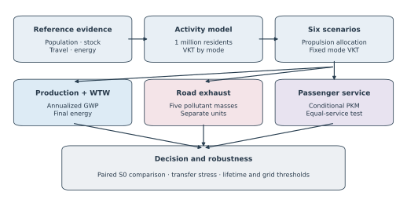
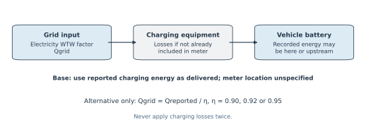
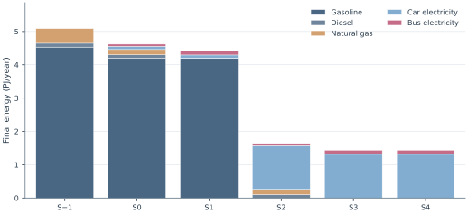
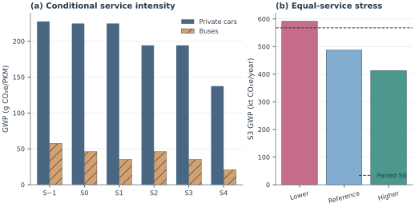
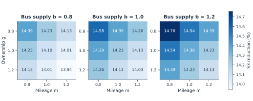

# Environmental Impacts of Vehicle Electrification in a City of One Million Residents

## Summary
We construct a transport-activity and environmental-accounting model for a representative urban population of one million, using Beijing as a traceable city-level empirical anchor rather than treating Beijing itself as the target city or assembling a synthetic city from separate national averages. Population-normalized vehicle ownership and annual travel are combined with a propulsion-allocation model to evaluate six fixed-travel electrification scenarios. Environmental impacts are quantified through final energy demand, annualized vehicle production plus well-to-wheel (WTW) greenhouse-gas emissions, and a separate road-exhaust inventory of CO, VOCs, NOx, PM2.5 and PM10. Under the reference assumptions, the prevailing-mix scenario requires 4.619 PJ of final energy and produces 567.789 kt CO2e per year within the modeled climate boundary. Full electrification reduces these quantities to 1.435 PJ and 486.978 kt CO2e, respectively (14.23% lower GWP). Halving the electricity WTW factor further reduces GWP to 341.002 kt CO2e. Bus-first electrification removes 71.08% of modeled baseline road NOx, whereas car-first electrification produces the larger climate benefit (12.60%). Paired uncertainty tests show that full electrification alone can lose its climate advantage under unfavorable lifetime and fuel-use assumptions, while the cleaner-electricity scenario retains a benefit in every tested combination. Conditional passenger-kilometre analysis complements fixed vehicle-kilometre comparison. The findings support coordinated vehicle and electricity decarbonization, with policy priority depending on the environmental objective.

**Keywords:** urban transport; electrification; representative city; life-cycle screening; road exhaust; sensitivity analysis

## 1. Problem analysis
Question 5 asks for quantitative environmental consequences of electrifying vehicles, including buses, in a city of one million residents. Electric propulsion changes both energy efficiency and the location of emissions. A meaningful comparison therefore requires three steps: reconstruct transport demand, hold that demand comparable across propulsion alternatives, and calculate climate and local exhaust impacts in separate physical units. We analyze private passenger cars and public buses; taxis, ride-hailing, freight, rail and infrastructure are not added to this defined fleet scope. The model estimates a hypothetical city, not a geographic subdivision of Beijing.

*Figure 1. Modeling framework for the million-resident representative city. Beijing supplies the main empirical anchor; its activity evidence is standardized to the one-million-resident target. Jinhua is reserved for external migration sensitivity rather than used to define the base case.*

## 2. Representative-city construction
### 2.1 Reference-system selection and the national-average alternative

National statistics are valuable for describing national totals and broad tendencies, but a national-average vector is not automatically a coherent city profile. Let \(\mathbf{x}_c=(n_c,d_c,v_{B,c},s_{c,1},\ldots,u_{c,k})\) denote the joint transport profile of city \(c\), including vehicle ownership, private-car travel intensity, bus vehicle-kilometres, propulsion shares and energy-use parameters. A national mean can be written as \(\bar{\mathbf{x}}=\sum_c w_c\mathbf{x}_c\), where \(\sum_c w_c=1\). Even when every component is accurately measured and uses a harmonized definition, the mean vector need not coincide with the observed profile of any one city. Averaging the components separately also suppresses their joint dependence: a national-average car-ownership rate, annual mileage, bus supply and propulsion mix do not necessarily occur together in the same urban system. If published indicators additionally differ in denominator, geographic coverage, reference year or weighting scheme, combining them can introduce further incompatibility. Scaling each national mean to one million residents would therefore create a synthetic composite city, not a population-scaled observation of a real city.

This does not make national averages inaccurate or useless. They are appropriate for national totals and macro-level comparisons; a deliberately defined national-average synthetic city could also be studied if its multivariate distributions and cross-variable relationships were retained. That is not the design adopted here. The present model requires a traceable city-level empirical anchor so that private-car activity, bus operations, propulsion allocation and charging-energy evidence can be interpreted within an identifiable urban reference system. National statistics may still be used as explicitly labelled individual technical proxies where a city-specific parameter is unavailable—for example, the national BEV share within NEVs used in the propulsion allocation—but they are not combined into a substitute national-average city activity profile.

Beijing is selected as the main empirical reference not because it is assumed to be typical of million-resident cities, but because the pre-contest evidence assembled for this study provides a comparatively traceable set of city- and operator-level observations for the model's defined scope: 2022 municipal population and private small/micro passenger-vehicle stock [1,2], travel-distance and dispatch indicators [2], operator-reported bus vehicle-kilometres and boardings [3], and charging-energy evidence and a 2023 fleet-composition snapshot [4]. These records allow the private-car and bus activity chain to be reconstructed from identifiable sources rather than inferred by combining unrelated national marginal averages.

The Beijing evidence is not a perfectly matched panel. The municipality-wide population and private-car stock, central-city travel/dispatch indicators, operator-system bus activity, and April 2023 propulsion snapshot differ in spatial coverage and/or reference year. The model therefore uses the full-municipality population denominator for the municipality-wide car stock, keeps the bus operator's service scope explicit, does not equate a mixed electric-drive category with pure BEVs, and tests the conditional mileage interpretation and transfer multipliers. The 2022 activity observations were published before the November 2023 competition; the April 2023 fleet snapshot informs technology composition only, not annual bus activity. The pandemic-affected 2022 travel year is retained as a limitation rather than silently treated as a normal year.

Beijing's population was far above one million, so Beijing itself is not the target city. Its observed rates are standardized to \(P=1{,}000{,}000\) to construct a model-defined target scenario. This is a controlled reference-city transfer, not a claim that every real million-resident city—or any single real city—has all the resulting characteristics. The transfer multipliers are examined in sensitivity analysis. Jinhua remains a separate external migration-sensitivity case for assessing how far the Beijing-anchored assumptions transfer to a smaller, near-million-scale urban area; it does not replace Beijing or define the base-case inputs.

### 2.2 Assumptions
1. The target has exactly P=1,000,000 residents. Per-capita reference rates are an initial transfer scenario, not a universal scaling law.
2. Vehicle-kilometres (VKT) by mode are held constant for propulsion comparisons. No traffic-demand growth or modal shift is imposed.
3. Vehicle production is allocated over lifetime VKT under steady-state replacement; the initial traction battery is already included in the applicable production factors.
4. Energy supply WTW and road exhaust are separate reporting boundaries. A cleaner grid changes electricity-related climate impact, not vehicle activity.
5. Unobserved propulsion shares and occupancy are explicitly varied. Missing maintenance, end-of-life, infrastructure and non-exhaust flows are not zero-filled.

### 2.3 Notation
| Symbol | Meaning | Unit |
|---|---|---|
| P, P_r | Target and reference resident populations | persons |
| N_r | Reference private passenger vehicles | vehicles |
| d, a | Conditional daily distance and dispatch fraction | km/day; dimensionless |
| g, m, b | Ownership, mileage and bus supply transfer multipliers | dimensionless |
| V_i, V_ik,s | Annual mode VKT and technology-specific VKT in scenario s | vehicle-km/year |
| p_ik,s | Technology share of mode VKT | dimensionless |
| u_kf | Energy use by carrier f | L/km, MJ/km or kWh/km |
| M_k, L_k | Production GWP and lifetime distance | kg CO2e/vehicle; km |
| F_f | WTW emissions factor | kg CO2e per carrier unit |
| A_kj | Road exhaust factor of pollutant j | g/vehicle-km |
| o_i | Distance-weighted effective occupancy | persons |

### 2.4 Activity and allocation
Let V_P=P(N_r/P_r)(365 d a)gm and V_B=P(V_B,r/P_r)b. The reference multipliers are one. Using d=49.9 km/day and a=0.461 conditionally gives 8,396.42 km/car-year; the source does not establish matched denominators, so 18,213.50 km/car-year (without dispatch adjustment) is tested separately. The target contains approximately 225793 private cars, 1.896 billion private vehicle-km and 45.049 million bus vehicle-km per year. Applying the April 2023 operator fleet snapshot only as a stock-density proxy gives roughly 1087 buses per million residents. We do not equate the mixed electric-drive group with pure BEVs. For each mode V_ik,s=V_i p_ik,s and sum_k p_ik,s=1. Private NEV share 8%, national BEV fraction within NEVs 77.8%, equal per-vehicle mileage, and 80% BEV allocation of mixed bus activity are illustrative proxies, not observed shares. Conventional bus activity is allocated using the diesel:natural-gas snapshot count ratio; the unclassified residual is preserved and allocated conditionally.

*Figure 2. Conditional mode-specific annual VKT allocation; 2022 reference activity and April 2023 propulsion snapshot. Shares are modeled, not directly observed.*

## 3. Environmental accounting
### 3.1 Scenario design
| Scenario | Private cars | Buses | Electricity WTW factor |
|---|---|---|---|
| S-1 | All gasoline | Diesel and natural gas | Reference |
| S0 | Estimated propulsion mix | Estimated propulsion mix | Reference |
| S1 | S0 mix | All BEV | Reference |
| S2 | All BEV | S0 mix | Reference |
| S3 | All BEV | All BEV | Reference |
| S4 | All BEV | All BEV | Half reference |

S4 is a policy stress, not a forecast of an observed future grid.

*Figure 3. System boundaries: production plus WTW GWP, separate road exhaust, and unquantified stages. The battery-only LCIA is not added to vehicle production.*

### 3.2 Energy and climate model
For mode i and technology k, carrier demand Q_ikf,s=V_ik,s u_kf. For a PHEV, fuel and electric demand are weighted by 1-UF and UF, respectively (UF=0.66 reference [12]). Report final energy after conversion to MJ; electricity is 3.6 MJ/kWh. The reference car gasoline consumption is 7.5 L/100 km, electric car and bus consumption are 0.192289 and 0.758253 kWh/km, derived from the 2023 charging report's October 2022 group means [4]. The reported charging quantity is not tied to a documented meter position; no extra losses are applied in the base case. The 2023 report table is available as a transcription, rather than an archived original PDF. Alternative charging efficiencies of 0.90–0.95 are tested. Historical bus energy rates and air-conditioning scenarios come from Lin et al. [5]. Fuel WTW factors use Peng et al. [6]: gasoline 90.2, diesel 92.3, CNG 72.0 and LNG 78.1 g CO2e/MJ; electricity 0.73224 kg CO2e/kWh. A 50/50 CNG/LNG energy split is a proxy.

Annual included-stage climate impact, in t CO2e/year, is G_s=(sum_ik V_ik,s M_k/L_k + sum_ikf Q_ikf,s F_f)/1000, with all factors converted to kg units. The production terms use Qiao et al. [7] for ICEV (9.985 t/vehicle) and BEV-NMC (15.005 t/vehicle), Xiong et al. [8] component-sum PHEV proxy (8.67043 t/vehicle), and Lin et al. historical bus materials plus assembly/distribution (42.84, 45.36, 46.35, 47.748 t/vehicle for diesel, natural gas, hybrid and BEV). Reference lifetimes are 150,000 km for cars and 400,000 km for buses. These studies differ in technology age and production scope; results are a matched-metric screening, not a verified identical cradle-to-grave inventory. No stand-alone battery GWP is added to a production factor already including it. The bus production conversion is f o L / 10^6 tonnes per vehicle for f in kg CO2e per 1,000 passenger-km; the same historical effective occupancy used by the source is used to undo its service normalization.

*Figure 4. Charging-energy measurement boundary. Charging efficiency is varied only under the battery-side interpretation; the original meter location is unknown.*

### 3.3 Road exhaust
For pollutant j, H_sj=sum_ik V_ik,s A_kj/1,000,000 t/year. National basic factors from the August 2023 consultation draft, Appendix F, [9] are used with China V as the illustrative reference, China IV and VI as stress cases. BEVs have zero modeled combustion exhaust. PHEV exhaust follows combustion distance; the mixed non-BEV bus group uses a diesel-based proxy. CO, VOCs, NOx, PM2.5 and PM10 remain independent quantities. PM size categories overlap and must not be summed. No concentration or health-effect claim is made.

### 3.4 Passenger service
The primary comparison is fixed VKT within each mode. To compare service intensities, define PKM_i=V_i o_i. Conditional bus PKM is scaled boardings times an assumed boarding-leg distance. A historical Beijing central-city trip distance of 10.9 km [10] and historical car occupancy of 1.24 persons/trip [11] are transfer proxies; actual matched bus PKM is unavailable. This implies 861.3 million bus PKM (effective occupancy 19.12) and 2.351 billion car PKM. For an equal-service stress, fix each mode's S0 PKM and use V_i,s=PKM_i,0/o_i,s; scale production and WTW burdens accordingly. This is not a modal substitution model.

## 4. Results
### 4.1 Annual energy by mode and carrier
| Scenario | Gasoline (ML) | Diesel (TJ) | Gas (TJ) | Car electricity (GWh) | Bus electricity (GWh) | Final energy (PJ) |
| --- | --- | --- | --- | --- | --- | --- |
| S-1 | 142.19 | 114.50 | 452.92 | 0.00 | 0.00 | 5.099 |
| S0 | 131.67 | 103.08 | 158.23 | 26.96 | 17.78 | 4.619 |
| S1 | 131.67 | 0.00 | 0.00 | 26.96 | 34.16 | 4.417 |
| S2 | 0.00 | 103.08 | 158.23 | 364.55 | 17.78 | 1.638 |
| S3 | 0.00 | 0.00 | 0.00 | 364.55 | 34.16 | 1.435 |
| S4 | 0.00 | 0.00 | 0.00 | 364.55 | 34.16 | 1.435 |

S3 reduces final energy by 68.93%; S4 has the same final energy as S3. Its lower emissions reflect energy-supply decarbonization, not additional vehicle efficiency.

*Figure 5. Annual final energy by carrier, PJ/year, for the one-million-resident target. S3 and S4 have identical energy demand.*

### 4.2 Climate change by mode and stage
| Scenario | Car WTW | Car production | Bus WTW | Bus production | Total | Reduction (%) |
| --- | --- | --- | --- | --- | --- | --- |
| S-1 | 408.770 | 126.201 | 44.560 | 5.057 | 584.589 | -2.96 |
| S0 | 398.280 | 129.855 | 34.408 | 5.245 | 567.789 | 0.00 |
| S1 | 398.280 | 129.855 | 25.012 | 5.377 | 558.525 | 1.63 |
| S2 | 266.940 | 189.649 | 34.408 | 5.245 | 496.242 | 12.60 |
| S3 | 266.940 | 189.649 | 25.012 | 5.377 | 486.978 | 14.23 |
| S4 | 133.470 | 189.649 | 12.506 | 5.377 | 341.002 | 39.94 |

All climate quantities are kt CO2e/year for the million-resident reference city. S3's higher production burden is offset by reduced WTW emissions. Car-first electrification gives a larger aggregate climate reduction because private travel accounts for the majority of VKT. Under this additive fixed-VKT model the interaction S1+S2-S0-S3 is zero within rounding, not an independently estimated synergy.

*Figure 6. Annual included-stage GWP (production plus WTW), separated by vehicle mode. Panels use independent vertical scales.*

### 4.3 Local road pollutants
| Scenario | CO | VOCs | NOx | PM2.5 | PM10 |
| --- | --- | --- | --- | --- | --- |
| S-1 | 1087.752 | 230.944 | 728.715 | 7.645 | 7.857 |
| S0 | 968.961 | 212.230 | 364.259 | 6.830 | 7.004 |
| S1 | 930.486 | 210.676 | 105.338 | 5.267 | 5.267 |
| S2 | 38.475 | 1.554 | 258.921 | 1.563 | 1.737 |
| S3 | 0.000 | 0.000 | 0.000 | 0.000 | 0.000 |
| S4 | 0.000 | 0.000 | 0.000 | 0.000 | 0.000 |

All entries are tonnes/year of modeled road combustion exhaust. The private/bus breakdown is retained in Appendix A. Bus-first removes most modeled NOx in the reference case; car-first removes most CO and VOCs. Electrification eliminates covered combustion exhaust in S3 and S4, but tire/brake wear, road dust, evaporative emissions and upstream pollution are not thereby eliminated.

*Figure 7. Mode-specific combustion-exhaust screening, tonnes/year, China V illustrative reference. Panel scales differ; non-exhaust and upstream pollutants are excluded.*

### 4.4 Functional-unit comparison
| Scenario | Car g/VKT | Bus g/VKT | Car g/PKM | Bus g/PKM |
| --- | --- | --- | --- | --- |
| S-1 | 282.18 | 1101.42 | 227.56 | 57.61 |
| S0 | 278.57 | 880.24 | 224.66 | 46.04 |
| S1 | 278.57 | 674.59 | 224.66 | 35.28 |
| S2 | 240.84 | 880.24 | 194.22 | 46.04 |
| S3 | 240.84 | 674.59 | 194.22 | 35.28 |
| S4 | 170.43 | 396.98 | 137.45 | 20.76 |

Units are g CO2e per indicated distance, production plus WTW. The conditional bus intensity per passenger-km is lower than private-car intensity despite higher vehicle-km intensity. The result depends on effective occupancy and trip length; it is not a measured service comparison. The distinction is central to the bus LCA framework [5].

*Figure 8. Conditional passenger-service intensities and equal-service S3 stress; 10.9-km bus trip and 1.24 car occupancy proxies, not actual PKM.*

## 5. Sensitivity and decision conditions
### 5.1 Population transfer
Vary g,m,b independently in {0.8,1,1.2}. Across 27 matched parameter sets at reference technical intensities, S3 reduction ranges 13.94–14.76%. This tests plausible deviations from linear per-capita activity transfer, not real-city calibration. Jinhua is reserved for a separate external migration-sensitivity check; it does not replace Beijing or enter the base-case inputs. Any post-cutoff Jinhua evidence is retrospective validation, not information available at the November 2023 contest cutoff.

*Figure 9. Paired S3 reduction across 27 city-transfer settings; common color scale, reference technology intensity, no retrospective Jinhua inputs.*

### 5.2 Technology and activity uncertainty
Cross the transfer grid with two mileage-denominator interpretations, 15 energy cases, two manufacturing source sets, three car lifetimes and three bus lifetimes. Compare each scenario with S0 under the same parameter settings. These are deterministic stress envelopes, not confidence intervals or probabilities.

| Scenario | Minimum (kt) | Maximum (kt) | Min reduction (%) | Max reduction (%) |
| --- | --- | --- | --- | --- |
| S-1 | 308.75 | 2185.10 | -6.49 | -0.28 |
| S0 | 298.34 | 2138.68 | 0.00 | 0.00 |
| S1 | 290.91 | 2127.62 | 0.33 | 3.82 |
| S2 | 240.05 | 1866.48 | -6.46 | 33.36 |
| S3 | 230.95 | 1857.02 | -6.01 | 33.77 |
| S4 | 152.13 | 1377.11 | 19.88 | 57.36 |

The full monotone climate ordering holds in 14,223 of 14,580 tested sets. S3 can increase GWP by 6.01% at the combination of low gasoline use, a 100,000-km car lifetime, high ownership and mileage multipliers, and the alternative mileage denominator. S4 remains beneficial throughout the tested grid. In 337/432 exhaust stress sets bus-first is better for NOx; car-first is better in 95/432. These frequencies describe the selected design only.

*Figure 10. Deterministic climate-reduction envelope across 14,580 paired parameter sets; not a confidence interval.*

### 5.3 Equal passenger service
| Occupancy stress | S3 equal-service GWP (kt/year) | Reduction vs paired S0 (%) |
| --- | --- | --- |
| reference | 486.978 | 14.23 |
| BEV_lower | 591.056 | -4.10 |
| BEV_higher | 413.188 | 27.23 |

The lower-occupancy case uses BEV occupancy multipliers 0.81 for cars and 0.8 for buses; the higher case uses 1.2 for both. The resulting reversal emphasizes that preserving passenger service is distinct from preserving vehicle travel.

### 5.4 Technology break-even
For a gasoline car and BEV with identical lifetime distance L, the threshold electricity intensity is F_e*=[M_ICE/L-M_BEV/L+u_g F_g]/u_e. At L=150,000 km, the current inputs give 0.947 kg CO2e/kWh. A cleaner grid or longer lifetime increases the feasible margin; the threshold is conditional on the selected manufacture and energy rates.

*Figure 11. Current contest-time BEV-NMC break-even electricity WTW factor as lifetime changes. Reference grid and S4 policy stress shown separately.*

## 6. Model verification and evaluation
Checks include propulsion VKT conservation, carrier-energy consistency, separation of pollutant species and GWP, stage and mode reconciliation, paired baselines and passenger-service conservation. The evidence hierarchy distinguishes observations, literature proxies and design assumptions. Reference-city transfer, the private mileage denominator, charging boundary, production scope and fleet emission-standard distribution limit absolute precision. The model does not cover all cradle-to-grave stages or every ecological indicator; a separate battery-only LCIA must not be added to the included-stage GWP without boundary reconciliation. These limitations qualify the scope of the conclusions, rather than replacing the numerical answer.

A supplementary historical bus-scrapping sensitivity (Lin et al. [5], Figure 2) adds 176.4 t CO2e/year to S0 and 264.2 t/year to S3, without changing the main boundary. The corresponding S3 reduction is 14.21%. This isolated expansion does not resolve private-vehicle disposal, maintenance, recycling or infrastructure.

## 7. Conclusion
For a million-resident hypothetical city, the reference mix produces 567.789 kt CO2e/year within the included production and WTW boundary. Full electrification lowers this to 486.978 kt, while lower-carbon electricity further lowers it to 341.002 kt. The reference result favors private-car electrification for climate and bus electrification for NOx; occupancy, lifetime, grid intensity and fuel consumption determine how strongly these findings transfer. A coordinated strategy of electrification, cleaner electricity and efficient passenger service is supported under the tested assumptions.

## References
[1] Beijing Municipal Bureau of Statistics. 2022 Statistical Communiqué (March 2023). https://tjj.beijing.gov.cn/zxfbu/202303/t20230320_2940009.html
[2] Beijing Transport Institute 2023 annual report, contemporary secondary coverage (August 2023). https://www.sohu.com/a/715705099_100106037
[3] Beijing bus operator 2022 activity, contemporary reporting (July 2023). https://bj.people.com.cn/n2/2023/0703/c14540-40479551.html
[4] 2023 China Major Cities Charging Infrastructure Monitoring Report, Table 4-1; publication corroboration https://www.ndanev.com/2023/10/20/1-194/ (transcribed report table; original PDF not archived).
[5] Lin et al. (2015). Beijing bus energy-saving and greenhouse-gas mitigation potential based on LCA. Acta Scientiae Circumstantiae 35(2), 576–584. https://html.rhhz.net/hjkxxb/html/20140430001.htm
[6] Peng et al. (2017). China vehicle fuel-cycle analysis. https://doi.org/10.3390/su9122183
[7] Qiao et al. (2017). Vehicle production greenhouse-gas study. https://doi.org/10.1016/j.apenergy.2017.05.041
[8] Xiong et al. (2019). Vehicle-cycle study. https://doi.org/10.3390/en12050834
[9] Technical guideline on city-level air pollutant emission inventory development, August 2023 consultation draft, Appendix F. https://cmsfiles.zhongkefu.com.cn/cmshuanjingapp/upload/resource/W020230822432828039219.pdf
[10] Beijing urban travel-distance study (2020), Table 1. https://doi.org/10.16037/j.1007-869x.2020.08.001
[11] Historical Beijing car occupancy study (2016). https://www.chinautc.com/upload/accessorychinautc/201610/201610181511515686617.pdf
[12] Beijing PHEV actual utility factor study (2021). https://doi.org/10.3390/wevj12040169

## Appendix A. Road exhaust by mode (tonnes/year)
| Scenario | Mode | CO | VOCs | NOx | PM2.5 | PM10 |
| --- | --- | --- | --- | --- | --- | --- |
| S-1 | private | 1004.803 | 227.503 | 113.751 | 5.688 | 5.688 |
| S-1 | bus | 82.949 | 3.441 | 614.964 | 1.957 | 2.169 |
| S0 | private | 930.486 | 210.676 | 105.338 | 5.267 | 5.267 |
| S0 | bus | 38.475 | 1.554 | 258.921 | 1.563 | 1.737 |
| S1 | private | 930.486 | 210.676 | 105.338 | 5.267 | 5.267 |
| S1 | bus | 0.000 | 0.000 | 0.000 | 0.000 | 0.000 |
| S2 | private | 0.000 | 0.000 | 0.000 | 0.000 | 0.000 |
| S2 | bus | 38.475 | 1.554 | 258.921 | 1.563 | 1.737 |
| S3 | private | 0.000 | 0.000 | 0.000 | 0.000 | 0.000 |
| S3 | bus | 0.000 | 0.000 | 0.000 | 0.000 | 0.000 |
| S4 | private | 0.000 | 0.000 | 0.000 | 0.000 | 0.000 |
| S4 | bus | 0.000 | 0.000 | 0.000 | 0.000 | 0.000 |
