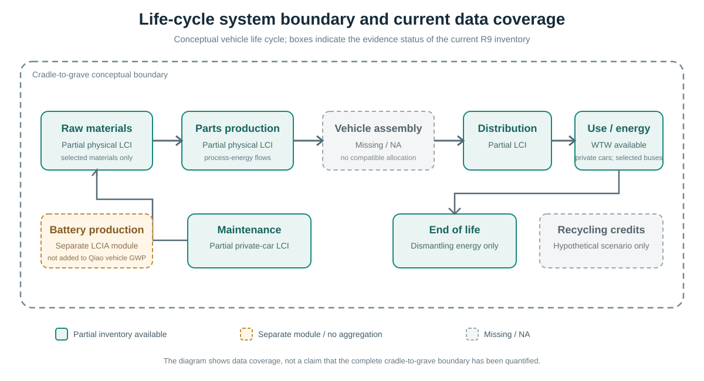
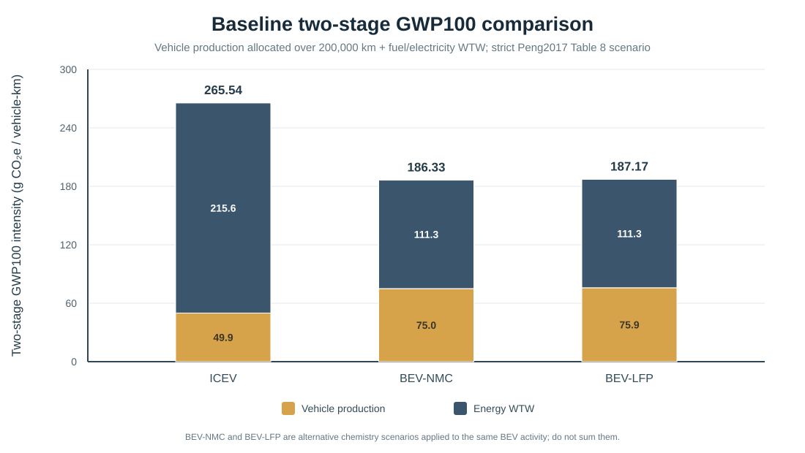
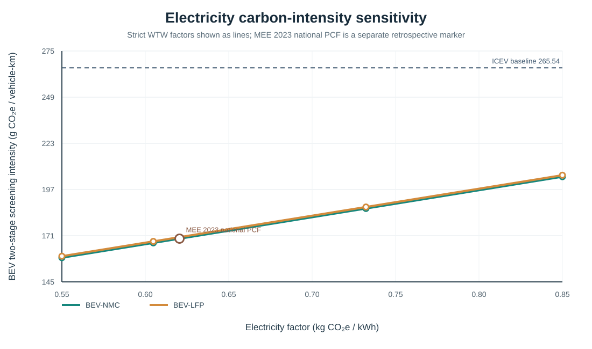
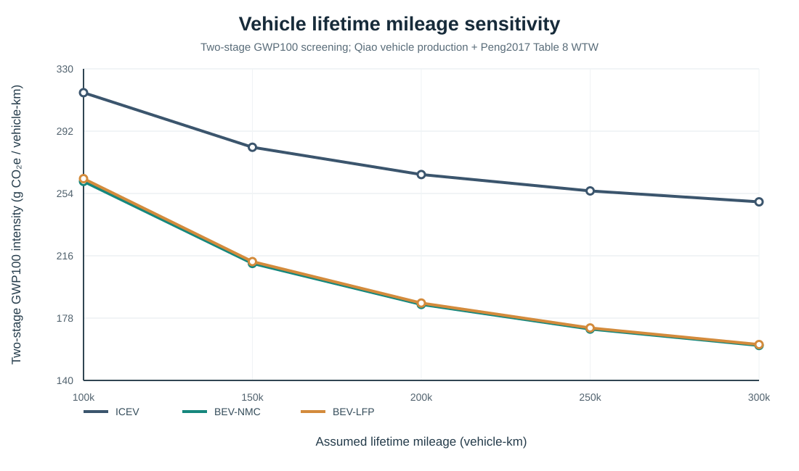
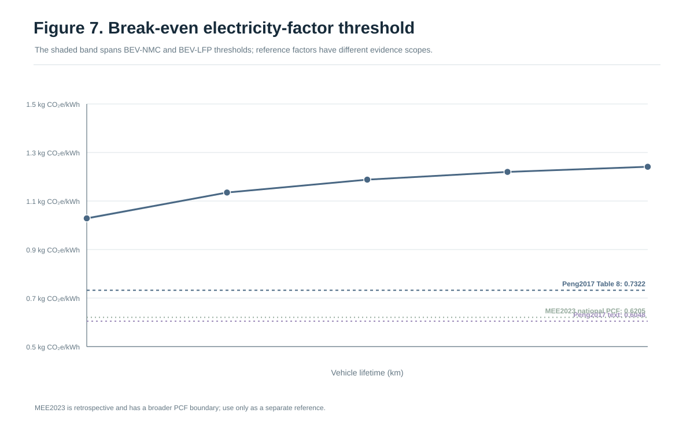
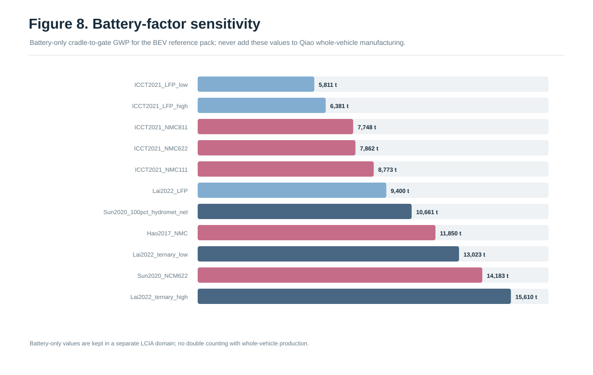

# Life-Cycle Environmental Assessment of Road Transport Technologies in a Beijing Reference City

**Working draft — R9.5**  
**Status:** Preliminary English paper sections; not a final submission.  
**Evidence rule:** The strict competition-time analysis uses sources published before the 2023 contest. Official 2023 electricity factors published in 2025 are reported only as retrospective checks.

## Abstract

This study develops a traceable life-cycle assessment framework for road-transport technologies in a 2023 Beijing reference city scaled to one million residents. The available evidence does not support a complete cradle-to-grave inventory for every vehicle class. To avoid false aggregation, the framework separates (i) physical pollutant mass flows, (ii) a two-stage climate-change screening that combines vehicle production with fuel and electricity well-to-wheel (WTW) emissions, and (iii) a battery-only life-cycle impact assessment. The strict two-stage comparison uses Qiao et al. (2017) vehicle-production factors and Peng et al. (2017) China WTW factors. Under the baseline assumption of 200,000 vehicle-km lifetime mileage, the estimated intensities are 265.54 gCO2e/km for ICEVs, 186.33 gCO2e/km for BEV-NMC, and 187.17 gCO2e/km for BEV-LFP. Sensitivity analysis shows that the BEV-NMC result ranges from 161.32 to 261.35 gCO2e/km as assumed lifetime mileage varies from 300,000 to 100,000 km. The break-even electricity WTW factor is approximately 1.253 kgCO2e/kWh for a 200,000-km BEV-NMC. These values are conditional two-stage screening results rather than complete life-cycle totals. Missing vehicle manufacturing, battery chemistry, bus fuel allocation, maintenance, and end-of-life flows are explicitly retained as unresolved inputs.

**Keywords:** Life-cycle assessment; vehicle electrification; well-to-wheel emissions; GWP100; sensitivity analysis; Beijing

---

## 1. Introduction

### 1.1 Background

Road transportation contributes to environmental burdens through several interconnected stages. Conventional internal-combustion vehicles generate emissions during fuel production and combustion, while battery-electric vehicles shift a substantial share of their operational energy demand to the electricity system and introduce additional production burdens associated with traction batteries. Consequently, comparing vehicle technologies only by tailpipe emissions can misrepresent their overall climate impacts.

Life-cycle assessment (LCA) provides a systematic framework for examining environmental burdens across material production, vehicle manufacturing, energy supply, vehicle operation, maintenance, and end-of-life treatment. However, a city-level assessment requires activity data, vehicle composition, energy-use parameters, and life-cycle factors that are often reported under different years, geographies, functional units, and system boundaries. Combining such data without harmonization can create artificial precision or double counting.

This study therefore adopts a gated integration strategy. Quantities are combined only when their physical meaning, units, and system boundaries are compatible. Where the evidence is incomplete, the relevant flow is retained as unavailable rather than replaced with zero.

### 1.2 Problem restatement and analytical scope

For the current environmental-assessment component of Problem 5, we operationalize the comparison around the major road-transport vehicle groups represented in the 2023 Beijing reference system. Private passenger vehicles are divided into internal-combustion vehicles (ICEVs), battery-electric vehicles (BEVs), and plug-in hybrid electric vehicles (PHEVs). The bus fleet is divided into diesel, an explicitly assumed electric allocation, natural-gas, unallocated mixed-propulsion, and unclassified groups.

The analysis has three distinct objectives:

1. Construct a traceable physical life-cycle inventory for the pollutant flows that can be calculated from the available activity and literature data.
2. Establish a comparable, but deliberately limited, climate-change screening model for vehicle production plus fuel/electricity WTW emissions.
3. Examine how the screening results respond to electricity carbon intensity, vehicle lifetime mileage, and battery-production factors.

The present draft does not claim that all vehicle groups have been modelled from cradle to grave. In particular, the available data do not yet support a complete two-stage GWP estimate for PHEVs and buses.

### 1.3 Overview of the proposed framework

The analysis proceeds through four stages. First, 2023 activity data are scaled to a one-million-resident reference city and converted into annual vehicle-kilometres and energy flows. Second, the physical inventory and climate-change screening are constructed separately. Third, battery impacts are evaluated as an independent module. Finally, sensitivity and break-even analyses are conducted on the subset of vehicle technologies for which manufacturing and energy factors can be paired.

*Figure 1. Overall structure of the R9.5 sensitivity and comparison framework.*

## 2. Model Preparation

### 2.1 System boundary and functional units

The study distinguishes three reporting domains:

- **Physical inventory:** kilograms of individual pollutant species per year and per vehicle-kilometre. The available species include CO2, VOC, NOx, PM2.5, and SO2.
- **Two-stage climate-change screening:** vehicle production plus fuel/electricity WTW, reported as tCO2e/year and gCO2e/vehicle-kilometre.
- **Battery-only LCIA:** characterized battery impacts reported by impact category. These indicators are not added to the physical pollutant inventory or to the Qiao vehicle-production factor.

The city-level annual total is a population-scaled reference flow. For technology comparisons, vehicle-kilometre is used as the current functional unit because consistent passenger-kilometre data are unavailable. The use of vehicle-kilometre does not imply equal passenger service across cars and buses; passenger-kilometre comparisons are deferred until compatible occupancy or passenger-flow data are available.

*Figure 2. Life-cycle system boundary and current evidence coverage. The diagram distinguishes partial inventory, separate battery LCIA, and missing stages.*

### 2.2 Assumptions and explanations

**Assumption 1.** The R7 activity scenario represents the annual activity of the 2023 reference city scaled to one million residents.

*Explanation:* The city-level values are derived from public statistics and documented allocation assumptions. They are not a census of individual vehicle odometers.

**Assumption 2.** The baseline fuel and electricity consumption rates are held constant per vehicle-kilometre during the parameter sensitivity analysis.

*Explanation:* This isolates the effect of electricity carbon intensity and vehicle lifetime. The fuel/electricity rates themselves remain uncertain and should be tested in a subsequent extension.

**Assumption 3.** Vehicle-production burdens are allocated uniformly over the assumed lifetime vehicle-kilometres.

*Explanation:* The calculation follows the lifetime-mileage allocation used in the source studies. The 150,000-km and 200,000-km cases are literature-based alternatives; 100,000, 250,000, and 300,000 km are additional stress-test assumptions rather than observed Beijing lifetimes.

**Assumption 4.** The Qiao BEV production factors already include the initial traction battery.

*Explanation:* Adding the separate Sun/ICCT battery module to the Qiao BEV production factor would double count battery manufacture. Battery-only results are therefore reported separately.

**Assumption 5.** The Peng2017 Table 8 electricity WTW factor is the strict baseline; its text alternative is treated as a source-discrepancy sensitivity.

*Explanation:* The two values originate from different sections of the same publication and are not averaged. Post-2023 official electricity factors are excluded from the strict contest-time baseline.

**Assumption 6.** Missing flows remain NA.

*Explanation:* An unavailable manufacturing, fuel, or end-of-life factor is not equivalent to zero environmental burden. Partial subtotals are not described as complete life-cycle totals.

### 2.3 Notation

| Symbol | Definition | Unit |
|---|---|---|
| (VKT_v) | Annual vehicle-kilometres for vehicle class (v) | km/year |
| (Q_g) | Annual gasoline consumption | L/year |
| (Q_e) | Annual electricity consumption | kWh/year |
| (M_v) | Vehicle cradle-to-gate production GWP | kgCO2e/vehicle |
| (L) | Assumed lifetime mileage | km/vehicle |
| (EF_g) | Gasoline WTW GWP factor | kgCO2e/MJ |
| (EF_e) | Electricity WTW GWP factor | kgCO2e/kWh |
| (E_v) | Energy WTW GWP intensity | kgCO2e/vehicle-km |
| (I_v) | Two-stage GWP intensity | kgCO2e/vehicle-km |
| (C_b) | Battery pack capacity | kWh/vehicle |
| (F_b) | Battery-production GWP factor | kgCO2e/kWh |

## 3. Life-Cycle Inventory and Climate-Change Model

### 3.1 Activity and energy-flow construction

Annual vehicle-kilometres are taken from the R7 S0 screening scenario. The corresponding R9.2 foreground energy flows are used to derive technology-specific energy intensity. For the private ICEV group, the current scenario implies approximately 0.075 L of gasoline per vehicle-kilometre. For the BEV group, the current activity and charging data imply approximately 0.152 kWh per vehicle-kilometre.

The gasoline conversion uses a density of 0.74 kg/L and a lower heating value of 43.07 MJ/kg. Electricity is converted using 3.6 MJ/kWh. These are conversion assumptions, not direct measurements of the 2023 Beijing fleet.

### 3.2 Physical pollutant inventory

The physical inventory applies the available Yang et al. (2021) stage-specific factors to the scaled annual activity. The private-vehicle ledger covers the available material-production, parts-manufacturing, distribution, maintenance, end-of-life dismantling-energy, and energy-supply/use WTW flows. The bus module currently covers only diesel and the explicitly assumed electric allocation in the use-energy stage.

The resulting physical CO2 subtotal is therefore incomplete. Battery-manufacturing pollutant flows, some assembly flows, unallocated bus propulsion, and other missing stages remain unresolved. The physical CO2 mass is not converted into CO2e by adding it to the GWP screening table.

*Figure 3. Partial physical CO2 intensity by life-cycle stage for private passenger vehicles. Values are physical CO2 mass per vehicle-kilometre, not CO2e; missing flows are not shown as zero.*

### 3.3 Two-stage GWP100 screening

To obtain a limited but interpretable climate-change comparison, we combine vehicle production and energy WTW:

[
I_v(L,EF_e)=rac{M_v}{L}+E_v.
]

For an ICEV:

[
E_{ICEV}=
rac{Q_g}{VKT_{ICEV}}

ho_g LHV_g EF_g.
]

For a BEV:

[
E_{BEV}=
rac{Q_e}{VKT_{BEV}}EF_e.
]

The annual two-stage GWP is:

[
GWP_{v,annual}=
rac{VKT_v I_v}{1000}.
]

Qiao et al. (2017) provide the vehicle-production factors: 9,985 kgCO2e/vehicle for ICEV, 15,005 kgCO2e/vehicle for BEV-NMC, and 15,174 kgCO2e/vehicle for BEV-LFP. The baseline lifetime mileage is 200,000 km. Peng et al. (2017) provide the China fuel/electricity WTW factors; the Table 8 electricity factor of 203.4 gCO2e/MJ is equivalent to 0.73224 kgCO2e/kWh.

This model contains only two stages. Vehicle maintenance, end-of-life treatment, infrastructure, and the full set of non-exhaust emissions are not included in the two-stage GWP result.

### 3.4 Battery-only sensitivity module

Battery production is evaluated separately using chemistry-specific factors from ICCT (2021), Hao et al. (2017), Lai et al. (2022), and Sun et al. (2020). For a battery pack with capacity (C_b), production factor (F_b), and assumed service mileage (L_b), the battery-only intensity is:

[
I_b=rac{C_bF_b}{L_b}.
]

The BEV reference capacity is 40 kWh and the exploratory PHEV reference capacity is 12.8 kWh. The PHEV chemistry is not locally verified. No battery replacement is assumed within the stated service interval.

The battery-only result is not added to Qiao's BEV production factor because the latter already includes the initial battery.

## 4. Results and Sensitivity Analysis

### 4.1 Baseline two-stage comparison

At a lifetime mileage of 200,000 km and the Peng2017 Table 8 electricity WTW factor, the model produces:

| Vehicle type | Manufacturing (tCO2e/year) | Energy WTW (tCO2e/year) | Two-stage total (tCO2e/year) | Intensity (gCO2e/km) |
|---|---:|---:|---:|---:|
| ICEV | 97,927.50 | 422,922.67 | 520,850.17 | 265.54 |
| BEV-NMC | 32,056.35 | 47,555.98 | 79,612.34 | 186.33 |
| BEV-LFP | 32,417.40 | 47,555.98 | 79,973.38 | 187.17 |

BEV-NMC is approximately 29.83% lower than ICEV in this two-stage screening scenario. BEV-NMC and BEV-LFP are alternative chemistry cases applied to the same BEV activity; their annual totals must not be added.

*Figure 4. Baseline two-stage GWP100 intensity, decomposed into vehicle production and energy WTW.*

### 4.2 Sensitivity to electricity carbon intensity

Under the two Peng2017 WTW factors, BEV-NMC intensity changes from 166.95 to 186.33 gCO2e/km. The corresponding BEV-LFP intensity changes from 167.80 to 187.17 gCO2e/km. This indicates that the electricity factor materially changes the estimated magnitude of the BEV advantage.

*Figure 5. BEV two-stage intensity under alternative electricity factors. The MEE 2023 national electricity PCF is shown only as a retrospective method-transfer marker.*

### 4.3 Sensitivity to vehicle lifetime mileage

Increasing lifetime mileage lowers the manufacturing burden allocated to each vehicle-kilometre. Under the baseline energy factors, BEV-NMC intensity decreases from 261.35 gCO2e/km at 100,000 km to 161.32 gCO2e/km at 300,000 km. The corresponding ICEV intensity decreases from 315.46 to 248.90 gCO2e/km.

*Figure 6. Effect of assumed lifetime mileage on two-stage GWP intensity.*

### 4.4 Break-even electricity factor

The break-even electricity factor is obtained by equating the BEV and ICEV two-stage intensities. At 200,000 km, the BEV-NMC threshold is approximately 1.253 kgCO2e/kWh; the BEV-LFP threshold is approximately 1.248 kgCO2e/kWh.

*Figure 7. Break-even electricity WTW factor as a function of lifetime mileage. The horizontal lines show the Peng2017 baseline and the retrospective MEE national PCF marker.*

The threshold is conditional on the assumed gasoline consumption, BEV electricity consumption, manufacturing factors, and common lifetime mileage. It should not be interpreted as a universal threshold for all vehicle models or electricity systems.

### 4.5 Battery-production factor sensitivity

Across the literature factors considered, the BEV battery-only manufacturing intensity spans approximately 13.60–36.53 gCO2e/vehicle-km at a 150,000-km service interval. The range reflects differences in chemistry, production energy, source year, and system boundary.

*Figure 8. Battery-only GWP intensity under alternative literature production factors. The hypothetical 100% recycling-credit case is reported separately.*

These battery values are not added to the vehicle-production totals above. They quantify the battery module independently and expose the sensitivity associated with chemistry and production assumptions.

### 4.6 Retrospective electricity-factor cross-check

The Ministry of Ecology and Environment reported a 2023 national electricity carbon-footprint factor of 0.6205 kgCO2e/kWh in January 2025. Applying this national factor to the current BEV electricity intensity yields 169.34 gCO2e/km after adding the Qiao vehicle-production allocation. This is a mixed-vintage retrospective scenario, not a strict contest-time result.

A separate official 2023 Beijing average electricity CO2 factor of 0.5554 kgCO2/kWh was published in December 2025. It implies 84.42 gCO2/km for the BEV electricity-generation component. This factor covers generation CO2 only; it is not a WTW or CO2e factor and is therefore not combined with the two-stage GWP result.

## 5. Preliminary Model Evaluation

### Strengths

1. The three reporting domains are separated by physical meaning and system boundary, reducing the risk of double counting.
2. The two-stage GWP model uses an explicit functional unit and a transparent lifetime-mileage allocation.
3. Sensitivity analysis identifies the influence of electricity carbon intensity and lifetime mileage, while break-even analysis converts the comparison into a conditional decision threshold.
4. Missing manufacturing and bus flows remain NA rather than being silently treated as zero.

### Limitations

1. The Qiao vehicle-production factors are cross-study proxies and do not represent a matched sample of Beijing vehicles.
2. The BEV electricity-use rate is derived from a limited activity/charging data source; the meter boundary and charging losses require further verification.
3. The strict electricity WTW baseline is a 2015 China national factor, not a local 2023 Beijing factor.
4. PHEV and bus vehicle-production GWP factors are not yet available under a compatible boundary.
5. The battery-only sensitivity factors come from different studies and chemistry assumptions; the PHEV chemistry transfer is exploratory.
6. The present two-stage GWP excludes maintenance, end-of-life, vehicle infrastructure, and a complete harmonized LCIA.

## 6. Preliminary Conclusion

The R9.5 results indicate that, under the selected cross-study assumptions, BEV-NMC has a lower two-stage GWP intensity than ICEV. The estimated advantage is sensitive to lifetime mileage and electricity carbon intensity. At the 200,000-km baseline, the BEV-NMC break-even electricity WTW factor is approximately 1.253 kgCO2e/kWh.

These findings support a conditional comparison of vehicle production and energy WTW, not a complete ranking of all transport technologies across all environmental impact categories. A complete city-wide LCA requires additional vehicle manufacturing, bus propulsion, battery, maintenance, end-of-life, and passenger-service data.

---

## References

[1] Qiao Q, Zhao F, Liu Z, Jiang S, Hao H. Cradle-to-gate greenhouse gas emissions of battery electric and internal combustion engine vehicles in China. *Applied Energy*, 2017. https://doi.org/10.1016/j.apenergy.2017.05.041

[2] Peng T, Zhou S, Yuan Z, Ou X. Life Cycle Greenhouse Gas Analysis of Multiple Vehicle Fuel Pathways in China. *Sustainability*, 2017, 9(12):2183. https://www.mdpi.com/2071-1050/9/12/2183

[3] Yang et al. Life cycle environmental assessment of electric and internal combustion engine vehicles in China. *Journal of Cleaner Production*, 2021, 285:124899. https://doi.org/10.1016/j.jclepro.2020.124899

[4] Bieker G. A global comparison of the life-cycle greenhouse gas emissions of combustion engine and electric passenger cars. ICCT, 2021. https://theicct.org/wp-content/uploads/2021/06/Global-LCA-passenger-cars-jul2021_0.pdf

[5] Hao H, Mu Z, Jiang S, Liu Z, Zhao F. GHG Emissions from the Production of Lithium-Ion Batteries for Electric Vehicles in China. *Sustainability*, 2017, 9(4):504. https://doi.org/10.3390/su9040504

[6] Lai et al. Investigating greenhouse gas emissions and environmental impacts from the production of lithium-ion batteries in China. *Journal of Cleaner Production*, 2022. https://doi.org/10.1016/j.jclepro.2022.133756

[7] Sun et al. Life cycle assessment of lithium nickel cobalt manganese oxide (NCM) batteries for electric passenger vehicles, 2020. https://api.repository.cam.ac.uk/server/api/core/bitstreams/1e70e5ba-4d14-4a3e-bec7-e9a57337725e/content

[8] Ministry of Ecology and Environment, National Bureau of Statistics, and National Energy Administration. 2023 Electricity Carbon Footprint Factors, published 2025-01-23. https://www.mee.gov.cn/ywdt/zbft/202501/t20250123_1101258.shtml

[9] Ministry of Ecology and Environment and National Bureau of Statistics. Announcement on 2023 Electricity CO2 Emission Factors, published 2025-12-31. https://www.mee.gov.cn/xxgk2018/xxgk/xxgk01/202512/t20251231_1139517.html
